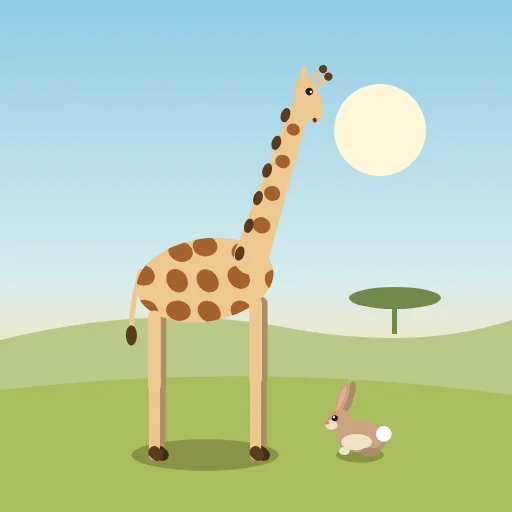

# Animal World

> 동물을 입양하고 가꾸는 관찰 게임 · [바로 하기](https://dannygu0214.github.io/Danny-Game-Center/games/animal-world/)

## 개요

동물을 지켜보며 점수를 모으고, 그 점수로 동물을 데려오고 지역을 꾸미는 게임이에요. 조이스틱 없이 누르기만 하면 돼요.

- **한 바퀴:** 관찰 → 인기 점수 → 입양과 꾸미기 → 발전도 상승 → 새 티어 해금
- **지역:** 초원 → 바닷가 → 사막 → 남극
- **콘텐츠:** 동물 32종, 꾸미기 물건 64종, 8단계 티어
- **마지막 단계:** 8티어에서 다리로 이어진 섬이 열리고, 지역마다 최대 44마리를 키울 수 있어요
- **그 밖에:** 짧은 순간을 찍는 앨범, 관람객 요청, 섬 꾸미기 도전

## 기술 사양

| 항목 | 내용 |
|---|---|
| 렌더링 | Canvas 2D 쿼터뷰. 동물 32종은 스프라이트 파일 없이 코드로 만든 2D 뼈대로 움직여요 |
| 외부 라이브러리 | 없음 (글꼴만 Google Fonts) |
| 소리 | 배경음악과 동물 소리를 모두 Web Audio로 합성 (음원 파일 없음) |
| 조작 | 모바일 세로 화면 우선. 누르기, 끌기, 두 손가락 확대, PC는 `Ctrl`+휠 |
| 저장 | `localStorage`, 저장 형식 버전 4 (이전 버전 저장을 자동으로 옮겨요) |
| 오프라인 | PWA, 서비스 워커 캐시 `animal-world-v17` |

## 코드 구조

| 부분 | 역할 |
|---|---|
| `logic.js` · `data.js` | 화면과 분리한 규칙과 수치표 |
| `rigs/` | 동물 32종의 개별 뼈대와 움직임 |
| `items/` · `art.js` · `terrain.js` | 꾸미기 물건, 지형, 하늘과 빛 |
| `sounds/` · `sound.js` · `music.js` | 합성 동물 소리와 음악 |
| `index.html` | 화면, 확대와 이동, 저장 |

테스트와 도구를 뺀 JavaScript·HTML은 약 14,000줄이고, 가장 큰 부분은 동물 뼈대예요. 자동 테스트는 46건이에요.

## 제작 방식

- 초원 하나로 먼저 만든 뒤 4개 지역으로 넓혔어요. 동물 뼈대는 AI 보조 에이전트에 나눠 맡겨 만들었어요.
- 밸런스는 자동 플레이 측정 도구로 확인하고, 뼈대·물건·소리는 전용 미리보기 화면으로 점검해요.
- 외부 그림과 음원 없이 모두 코드로 만들었어요.
- 개발 기간은 2026-10-25 ~ 11-19, 20커밋이에요.

## 상태

🟢 **완료 · 4개 지역 플레이 가능.** 지역별 섬까지 열려 있어요. 비밀 티어(9단계)와 지역별 배경음악은 만들지 않았어요. 이후의 새 작업은 3D 기반인 [Ocean World 3D](ocean-world-3d.md)로 이어졌기 때문에, 2D 버전은 지금이 완성본으로 보여요 `[추측]`.
