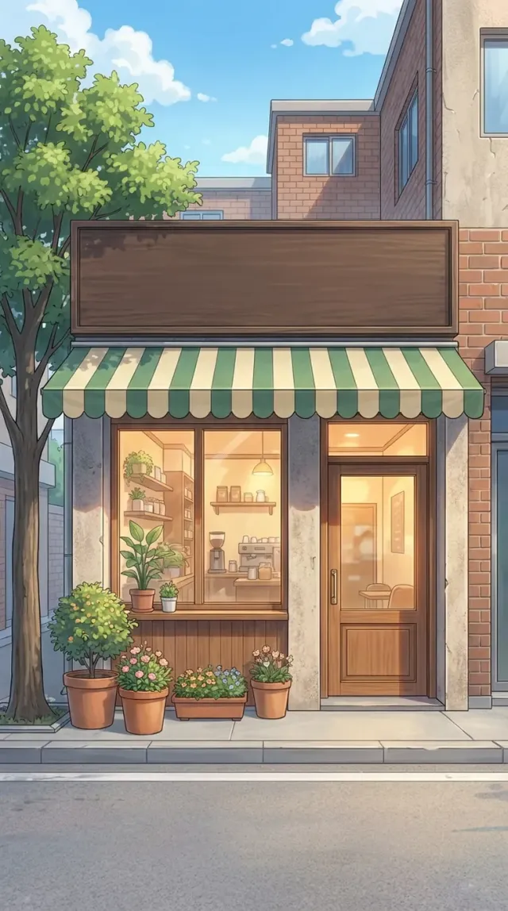

# My Little Cafe

> 회사를 그만두고 작은 카페를 물려받아요 · [바로 하기](https://dannygu0214.github.io/Danny-Game-Center/games/my-little-cafe/)

## 개요

은퇴를 앞둔 사장님의 카페를 물려받아 커피를 배우고 가게를 꾸려 가는 게임이에요. 대화 장면, 커피 만들기 미니게임, 가게를 내려다보는 영업 화면이 이어져요.

- **스토리 모드:** 튜토리얼을 겸한 5일간의 수업이에요. 주인공과 사장님의 성별, 상권, 카페 이름을 골라요.
- **맛 맞추기:** 날마다 달라지는 분쇄도를 맛의 균형(시큼함 ↔ 씀)을 보며 맞춰요. 별점은 커피의 맛과 만든 솜씨로만 정해요.
- **본게임:** 아침 준비 → 영업(실제 시간 약 5분) → 하루 마감을 되풀이하고, 봄 20일이 끝나면 계절 결산을 해요.
- **콘텐츠:** 커피 메뉴 7종, 커피 만들기 단계와 로스팅, 상권 2곳(오피스, 주택가), 단골과 이벤트, 장비 업그레이드 3종, 커피 노트

## 기술 사양

| 항목 | 내용 |
|---|---|
| 렌더링 | Canvas 2D + HTML 화면. 배경·인물·도구는 그림 파일, 손님 캐릭터와 효과는 코드 |
| 외부 라이브러리 | 없음 |
| 소리 | 날씨에 따라 바뀌는 생성 배경음악 8곡, 실패하면 합성곡. 효과음은 합성 |
| 조작 | 모바일 세로 화면 우선. 일부 단계는 휴대폰을 기울여 조작해요 |
| 저장 | `localStorage`, 저장 형식 버전 1 |
| 오프라인 | PWA, 서비스 워커 캐시 `my-little-cafe-v1` (MP3는 캐시하지 않아요) |

## 코드 구조

| 부분 | 역할 |
|---|---|
| `logic.js` · `business.js` | 화면과 분리한 규칙: 커피 판정, 스토리, 가게 운영 |
| `stations.js` | 커피 만들기 단계의 그림과 조작 |
| `main-mode.js` · `floor.js` · `events.js` | 영업 화면, 자리 배치, 이벤트 |
| `story.js` · `trivia.js` | 대본과 커피 이야기 |
| `index.html` · `art.js` · `art-shop.js` | 화면, 저장, 그리기 |

테스트와 도구를 뺀 JavaScript·HTML은 약 4,400줄이에요. 자동 테스트는 50건이고, 대사의 말투까지 검사해요.

## 제작 방식

- 커피 자료를 먼저 조사하고, 스토리 모드 → 봄 20일 본게임 순서로 만들었어요.
- 봄 한 계절의 수익 균형은 반복 시뮬레이션 도구로 확인해요.
- 배경과 인물 등의 그림은 Google Gemini 3 Pro Image로, 배경음악은 Suno로 만들었어요.
- 개발 기간은 2026-11-05 ~ 11-19, 17커밋이에요.

## 상태

🟡 **개발 중 · 스토리 모드와 봄 20일 플레이 가능.** 여름 이후 계절, 연말 엔딩 등은 만들 예정이에요.
