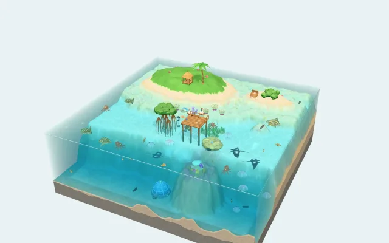

# Ocean World 3D

> 말랑한 젤리 바다 블록에 생물을 들여 키우는 3D 수족관 · **PC 전용** · [바로 하기](https://dannygu0214.github.io/Danny-Game-Center/games/ocean-world-3d/)

## 개요

투명한 젤리 블록에 담긴 열대 환초 바다를 꾸미고, 생물을 들여 지켜보는 게임이에요. [Animal World](animal-world.md)의 관찰형 흐름을 3D로 넓혔어요.

- **즐길 거리:** 블록을 돌리고 확대해 보기, 블록과 생물을 눌렀을 때의 젤리 반응 7가지, 5장짜리 그림 프롤로그
- **생물 8종:** 해삼, 소라게, 말미잘(흰동가리와 공생), 몰디브흰동가리, 문어, 보름달물해파리, 바다거북, 쥐가오리
- **꾸미기:** 물건 18종
- **성장:** 8단계 티어. 마지막 단계에서 블록이 옆으로 늘어나고 최대 44마리를 키워요
- **그 밖에:** 순간 포착, 관람객 요청

## 기술 사양

| 항목 | 내용 |
|---|---|
| 렌더링 | Three.js 0.187.0 (WebGL2). 외부 3D 모델 파일 없이 코드로 모델을 만들어요 |
| 성능 | 인스턴싱, 배치 렌더링, 공용 셰이더로 그리기 호출을 줄였어요. 개발 중 MacBook Air 전체 화면에서 60fps를 쟀어요 |
| 소리 | 배경음악, 생물 소리, 효과음을 모두 Web Audio로 합성 |
| 조작 | 마우스·트랙패드와 키보드. 휴대폰과 태블릿에는 안내 화면만 보여요 |
| 저장 | `localStorage`, 저장 형식 버전 1 |
| 오프라인 | PWA, 서비스 워커 캐시 `ocean-world-3d-v2` |

## 코드 구조

| 부분 | 역할 |
|---|---|
| `sim/` | Three.js와 화면에 기대지 않는 게임 규칙, 움직임, 저장 |
| `render/core/` | 땅과 바다가 함께 쓸 수 있는 3D 기반 |
| `render/aqua/` | 수면, 물속 안개, 빛 무늬, 물고기 떼 |
| `eco/atoll/` | 환초 생태계의 생물, 물건, 지형 |
| `ui/` · `audio/` | 화면 요소, 젤리 반응, 소리 |

테스트와 도구, 라이브러리를 뺀 JavaScript·HTML은 약 10,000줄이에요. 자동 테스트는 80건이고, 규칙이 나중의 육지 생태계에도 통하는지 확인하는 검사도 있어요.

## 제작 방식

- 조사와 설계 → 시제품과 노트북 성능 측정 → 생물과 물건 → 반응과 소리 → 설치형 앱 순서로 만들었어요.
- 플레이 습관별로 티어에 닿는 시간을 재는 도구와 화면 캡처·성능 측정 도구를 써요.
- 3D 모델, 소리, 아이콘은 코드로 만들었고, 프롤로그 그림은 Google Gemini 3.1 Flash Image로 만들었어요.
- 개발 기간은 2026-11-11 ~ 11-18, 56커밋이에요.

## 상태

🟡 **개발 중.** 환초 생태계는 마지막 티어까지 플레이할 수 있어요. 설계 문서에 있는 확장 생태계(남해안, 오호츠크해, 아마존 호수)와 일부 생물 모델 다듬기가 남아 있어요.
