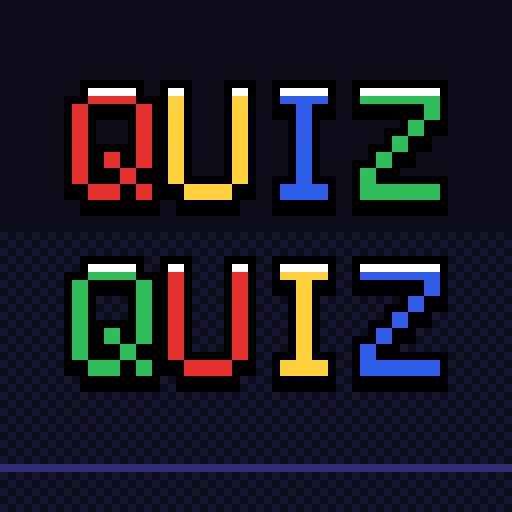

# Quiz Quiz 2026

> 90년대 예능 무대에서 두 팀이 겨루는 퀴즈쇼 · [바로 하기](https://dannygu0214.github.io/Danny-Game-Center/games/quiz-quiz-2026/)

## 개요

문제는 정확하게, 무대는 유쾌하게 만든 레트로 퀴즈쇼예요. 컴퓨터를 상대로 혼자 하거나, 한 화면에서 둘이 겨뤄요.

- **한 판:** 오프닝 → 몸풀기 6문제 → 분야 판에서 문제 고르기 → 주관식·숫자 문제로 역전 → 시상식. 동점이면 서든데스를 해요.
- **기회 규칙:** 한 문제를 두 팀이 번갈아 맞힐 기회를 얻고, 뒤의 기회에는 초성 힌트가 나와요. 틀려도 점수는 깎이지 않아요.
- **상대:** 컴퓨터 난이도 3단계
- **문제:** 6개 분야 660문항(과학, 역사, 지리, 예술, 일반상식 각 99문항, 넌센스 165문항). 4지선다 394, 글자 조각 주관식 211, 숫자 입력 55문항이에요.
- **기록:** 이긴 횟수에 따라 칭호가 올라가요.

## 기술 사양

| 항목 | 내용 |
|---|---|
| 렌더링 | Canvas 2D 도트 무대(480×270) + 그 위의 HTML 문제판과 점수판 |
| 외부 라이브러리 | 없음 |
| 소리 | 칩튠 효과음과 배경음악을 Web Audio로 합성 (음원 파일 없음) |
| 조작 | 가로 화면. 누르기와 클릭으로만 조작하고, 세로로 들면 돌려 달라고 안내해요 |
| 저장 | `localStorage` (설정, 기록, 최근에 나온 문제) |
| 오프라인 | 아직 없어요 |

## 코드 구조

| 부분 | 역할 |
|---|---|
| `logic.js` · `hangul.js` | 화면과 분리한 퀴즈 규칙, 초성과 글자 조각 처리 |
| `bank/` | 분야별 문제와 출처 목록 |
| `art.js` · `chars.js` | 도트 무대와 출연자 |
| `main.js` · `sound.js` · `index.html` | 진행, 소리, 화면 |

테스트와 도구를 뺀 JavaScript·HTML은 약 5,900줄이고, 절반 넘게가 문제와 출처예요. 자동 테스트는 28건이에요.

## 제작 방식

- 설계와 문제 검사 도구를 먼저 만들고, 정규전 한 판을 완성했어요.
- 문제는 위키백과, 국립국어원, 한국민족문화대백과사전 같은 자료를 바탕으로 새로 썼고, 문항마다 출처를 연결해 뒀어요. 위키백과는 CC BY-SA 자료예요.
- 자동 검사 도구로 중복, 말투, 출처 등을 확인하고, 모의 대결 도구로 승률과 판 길이를 재요.
- 그림과 소리는 모두 코드로 만들었어요.
- 개발 기간은 2026-11-14 하루이고, 4커밋이에요.

## 상태

🟡 **개발 중 · 정규전 한 판 플레이 가능.** 출연진 추가, 짧은 판, 새 놀이 방식, 오프라인 설치 등은 아직 만들지 않았어요.
