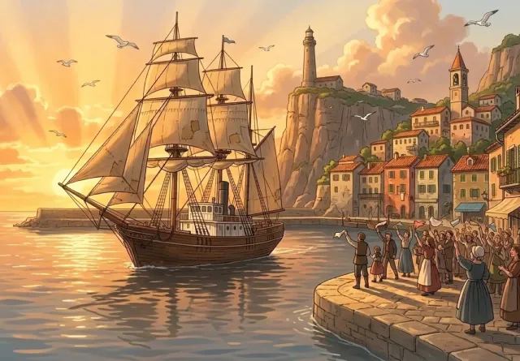

# Sailing Master

> 작은 호수에서 대양 너머 새 대륙까지 · [바로 하기](https://dannygu0214.github.io/Danny-Game-Center/games/sailing-master/)

## 개요

배를 직접 설계해 넓히고 선원을 배치하며 더 큰 물로 나아가는 항해 게임이에요. 전투는 없고, 날씨와 바다에 대비하는 것이 도전이에요.

- **한 바퀴:** 항해 계획(해도, 예보, 보급) → 출항 → 조종과 날씨 대응, 발견 → 입항(판매, 가공, 배 개조, 선원 고용) → 다음 수역
- **배 설계:** 선체 격자에 놓은 부품의 무게와 균형이 항해 성능이 돼요. 처음에는 직접 조종하고, 나중에는 선원에게 맡겨요.
- **세계:** 수역 6곳(작은 호수, 큰 호수, 강, 앞바다, 큰 바다, 대양), 항구 24곳, 발견지 53곳
- **콘텐츠:** 선체 15종, 부품 30종, 선원 역할 12종, 날씨 11종, 생물 도감 43종, 도전과제 30개
- **이야기:** 선장 4명의 출항 이야기와, 선장에 따라 갈리는 새 대륙 엔딩이 있어요. 엔딩 뒤에도 계속 항해할 수 있어요.

## 기술 사양

| 항목 | 내용 |
|---|---|
| 렌더링 | Canvas 2D 3/4 쿼터뷰, 층을 쌓아 그리는 배 |
| 외부 라이브러리 | 없음 |
| 소리 | 생성한 MP3 배경음악 4곡, 나머지는 합성곡이나 비슷한 곡으로 대체. 파도·바람 같은 환경음과 효과음은 합성 |
| 조작 | 모바일 세로 화면 우선. 누르기, 키 막대 끌기, 확대(PC는 마우스 휠) |
| 저장 | `localStorage`, 저장 형식 버전 9 (이전 버전 저장을 옮겨요) |
| 오프라인 | PWA, 서비스 워커 캐시 `sailing-master-v11` |

## 코드 구조

| 부분 | 역할 |
|---|---|
| `logic.js` · `ship.js` | 화면과 분리한 규칙: 항해 물리, 날씨, 경제, 선원, 선체 계산 |
| `world.js` · `data.js` | 지도, 항로 찾기, 조류, 수치표 |
| `art.js` · `art-ship.js` · `themes.js` · `creatures.js` | 물, 지형, 배, 생물 그리기 |
| `art-story.js` | 이야기 장면 |
| `index.html` · `music.js` · `sound.js` | 화면과 조작, 음악, 효과음 |

테스트와 도구를 뺀 JavaScript·HTML은 약 9,400줄이에요. 자동 테스트는 190건이에요.

## 제작 방식

- 손맛 시제품 → 담수 수역 → 앞바다 → 큰 바다 → 대양과 엔딩 순서로, 단계마다 계획 문서를 쓰고 만들었어요.
- 작은 호수에서 시작하는 자동 플레이 도구로 성장 속도와 엔딩까지의 흐름을 재요. 자동 플레이가 모든 판에서 엔딩에 닿는 것은 아니라서 밸런스는 계속 살피고 있어요.
- 배, 바다, 생물은 코드로 그려요. 선장 초상화 4장, 출항 이야기 그림 12장, 엔딩 그림 6장은 Google Gemini 3.1 Flash Image로 만들었고, 배경음악 4곡은 Suno로 만들었어요.
- 개발 기간은 2026-11-02 ~ 11-25, 76커밋으로 이 모음에서 커밋이 가장 많아요.

## 상태

🟢 **완료 · 6개 수역과 새 대륙 엔딩까지 플레이 가능.** 몇몇 장면의 전용 배경음악과 잠겨 있는 부품 1종은 아직이에요.
