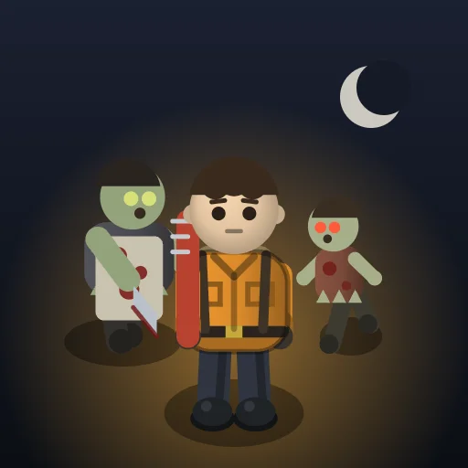

# Zombie Outpost

> 마지막 불빛을 지키는 좀비 서바이벌 · [바로 하기](https://dannygu0214.github.io/Danny-Game-Center/games/zombie-outpost/)

## 개요

무너진 도시에서 자원을 모으고 본부를 키우는 쿼터뷰 좀비 서바이벌이에요. 전투는 자동이고, 채집은 직접 해요. 캐릭터가 죽으면 그 판이 끝나는 로그라이크 방식이에요.

- **한 바퀴:** 필드 탐색(채집, 조난자 구출, 장비 수집) → 본부로 돌아와 건설·제작·동료 배치 → 전진기지 개척과 습격 방어
- **월드:** 7개 구역, 채집 대상물 580개(18종), 장애물 780개(20종)
- **성장:** 플레이어 Lv.99, 본부 Lv.10까지
- **콘텐츠:** 생존자 4명, 동료 직업 5종, 기지 건물 11종, 전진기지 후보지 12곳, 무기 16종과 맨주먹, 방어구 8종, 임무 7종
- **엔딩:** 목표 8개 중 필수 1개를 포함해 3개를 이루면 목표 엔딩이에요. 본부를 키울 때마다 픽셀 아트 컷씬이 나와요.

## 기술 사양

| 항목 | 내용 |
|---|---|
| 렌더링 | Canvas 2D 쿼터뷰, 타이틀·컷씬은 픽셀 버퍼와 디더링 |
| 외부 라이브러리 | 없음 (글꼴만 Google Fonts) |
| 소리 | 생성한 MP3 배경음악 7곡 + 같은 구성의 합성곡 대체, 효과음은 실시간 합성 |
| 조작 | 모바일 세로 화면 우선. 끌어서 움직이는 가상 조이스틱이고 PC에서는 마우스로 끌어요 |
| 저장 | `localStorage`, 저장 형식 버전 2 |
| 오프라인 | PWA, 서비스 워커 캐시 `zombie-outpost-v3` (MP3는 캐시하지 않아 오프라인에서는 합성곡이 나와요) |

## 코드 구조

| 부분 | 역할 |
|---|---|
| `logic.js` | 화면과 분리한 게임 규칙(전투, 채집, 건설, 습격, 저장) |
| `index.html` | 화면, 렌더링, 조작, 효과음 |
| `art.js` | 캐릭터 뼈대 애니메이션, 좀비, 건물, 무기 그리기 |
| `title.js` · `cutscene.js` | 픽셀 아트 타이틀과 컷씬 |
| `music.js` | 배경음악 재생과 합성곡 |

테스트와 도구를 뺀 JavaScript·HTML은 약 8,500줄이에요. 자동 테스트는 107건이에요.

## 제작 방식

- 선행 게임을 분석한 내용과 수치, 변경 이력을 설계 문서 하나에 쌓았어요.
- 자동으로 사냥하고 채집하는 측정 도구로 밸런스를 확인해요.
- 그림, 타이틀, 컷씬, 아이콘은 코드로 그렸어요. 배경음악은 Suno로 생성했어요.
- 개발 기간은 2026-10-25 ~ 11-19, 22커밋이에요. 첫 커밋 전에는 웹 프로토타입 단계에서 만들었어요.

## 상태

🟢 **완료 · 플레이 가능.** 시작부터 목표 엔딩, 본부 최고 레벨 엔딩까지 이어져요. 방어구가 캐릭터 겉모습에 보이지 않는 점과 후반 밸런스는 다듬을 여지가 있어요.
