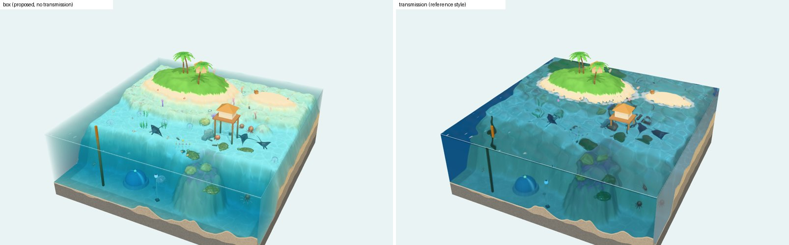
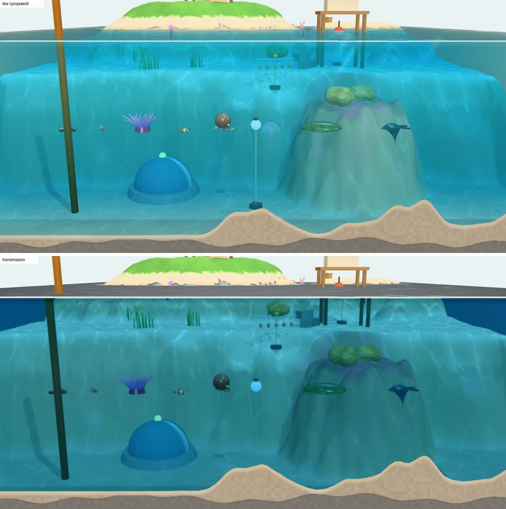
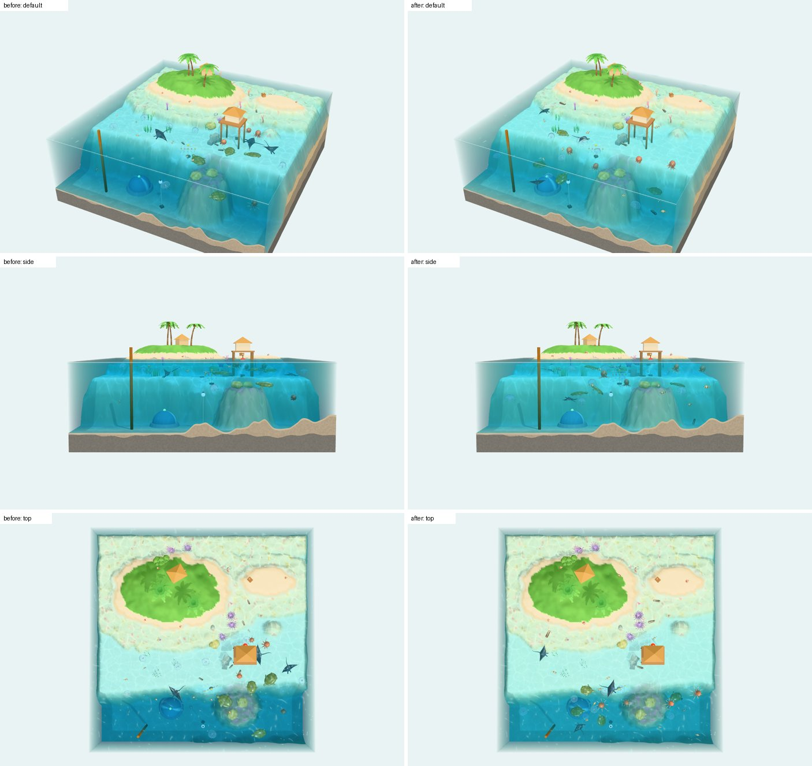

# Ocean World 3D — P1 기술 시제품 보고서

작성 2026-11-11 · 하위 세션(브랜치 `claude/ocean-world-3d-p1-proto`) · 대상: 메인 세션, 대니님

## 표기

| 표기 | 뜻 |
|---|---|
| **[확인]** | 이 원격 환경(헤드리스 크로미움 + SwiftShader 소프트웨어 WebGL2)에서 녹화 모드 화면이나 수치로 직접 확인했어요 |
| **[추정]** | 제 판단이에요. 확인하지 않았어요 |

이 환경의 프레임 속도는 소프트웨어 GPU라 의미가 없어서 **성능 근거로 쓰지 않았어요.** 드로우콜·삼각형 수는 GPU 종류와 무관한 값이라 근거로 썼어요.

## 0. 요약

- 조사 문서의 핵심 제안인 **투과 없는 물 덩어리**(물속 경로 길이 안개 + 상자 뒷면 물색 + 앞면 광택층)가 화면에서 의도대로 동작해요 [확인]. 투과 방식과 나란히 놓으면 차이가 분명해요: 투과 방식은 반투명 해파리·부유 입자가 사라지고 물속 색이 균일한 청록·남색으로 죽어요 [확인].
- 기본 장면(44마리, 그림자 켬, 기본 물)의 드로우콜은 **프레임당 19회**(본 화면 17 + 그림자 2), 투과 패스 0회예요 [확인]. 목표(300회)의 약 6%예요. 같은 장면을 투과 방식으로 그리면 29회(투과 패스 11회 추가)예요 [확인].
- `BatchedMesh`에 셰이더 조각 주입이 **돼요** [확인]. 컴파일된 셰이더 소스에 `USE_BATCHING`과 주입한 조각이 함께 들어 있고, 화면에서도 기둥의 물속 부분만 물빛에 잠겨요.
- 생물 8종 44마리가 종별 `InstancedMesh` 8개 + 꼭짓점 셰이더 변형으로 그려져요(해파리 박동, 물고기 꼬리 파동, 가오리 날갯짓, 거북 지느러미, 문어 분사, 해삼 꿈틀, 소라게 걷기, 말미잘 흔들림) [확인: 프레임 간 모양 변화].
- **노트북 프레임 속도는 아직 몰라요.** `?perf=1`로 재서 복사할 수 있게 해 두었어요(5절).
- 타이틀 화면(실제 장면 위 덮개, 누르면 블록이 출렁이며 시작)을 얹었어요(2절 표).
- 대니님 방향(2026-11-11: 크기 폭 줄이기, 생물을 깊은 곳까지 고르게, 생동감, 바다색 연하고 밝게)을 반영했어요(10절). 3절의 비교 그림은 반영 **전** 물빛으로 찍은 것이에요.
- 메인 세션이 정할 것: 확장 영역 옆면(PLAN 예시 `+y` 대신 `+x`로 정함, 6절), 생물 그림자 방침, 크기 배율·물빛 최종값(대니님 노트북 확인 뒤).

## 1. 만든 것

```
games/ocean-world-3d/
  index.html                 import map, 작은 UI(물 방식·시점·탁도·젤리 세기·개체 수·성능 표시)
  vendor/three-0.187.0/      npm 원본 그대로(LICENSE, build 2개, 애드온 3개, VENDOR.md에 sha256)
  eco/atoll/terrain.js       지형 정의(순수 함수, Node import 가능) — PLAN 4.3 약속
  eco/atoll/profile.js       빛·물빛·지형색·지층 값(순수 데이터)
  render/main.js             조립(core + aqua + eco). core와 aqua를 함께 아는 유일한 파일
  render/core/               생태계 무관 기반
    materials/shaderPatches.js  셰이더 조각 주입 전부(슬롯 등록·주입·캐시 키)
    stage.js camera.js jelly.js terrain.js instancing.js batched.js deform.js input.js coords.js app.js perf.js
  render/aqua/               물 전용: waterFog.js caustics.js heightfield.js surface.js swim.js particles.js buoyancy.js
  render/proto/              P1 확인용 임시: species.js props.js wander.js geo.js (P2·P3에서 교체)
  ui/title.js                타이틀 덮개(DOM + CSS, 스타일은 이 파일 안). 시작 동작은 main.js의 startGame() 하나
  tools/capture.mjs          녹화 모드 화면 저장·드로우콜 내보내기(Playwright)
```

| 경계 규칙(PLAN 3절) | 지켰는지 |
|---|---|
| `render/core/`는 `render/aqua/`를 import하지 않음 | [확인] grep 결과 0건. aqua는 `registerSlotPatch('medium', …)`로 core의 슬롯에 끼워 넣어요 |
| 셰이더 조각 주입은 한 모듈 | [확인] `onBeforeCompile`은 `shaderPatches.js`에만 있어요. GLSL 문자열 자체는 각 모듈(aqua/swim.js 등)에 있고, 주입 위치·방법만 한 곳이에요 |
| 지형 정의는 `eco/atoll/terrain.js` 한 곳 | [확인] 지형 메시·지층·물 격자·생물 이동·물건 배치가 모두 `heightAt`을 읽어요 |
| 격자↔Three 좌표 변환은 `render/core/` 한 곳 | [확인] `render/core/coords.js` |
| 외부 모델·텍스처·이미지·CDN·외부 글꼴 없음 | [확인] 모양은 전부 코드 생성, 환경맵은 `RoomEnvironment`(코드), 글꼴은 시스템 글꼴 |

`render/proto/`는 맡은 범위(`render/`) 안에 두었지만, 생물·물건 생성기는 PLAN 3절대로라면 `eco/atoll/species/`·`props/` 자리예요. P1에서는 그 폴더를 맡지 않아서 임시로 여기에 두었어요. P3에서 옮기면 돼요.

## 2. "아직 만들어 보지 않은 제안"별 결과(PLAN 1절)

| 제안 | 결과 | 근거 |
|---|---|---|
| 투과 없이 물 덩어리 그리기(물속 거리 안개 + 뒷면 물색 + 앞면 광택) | **됨** | [확인] 화면: 가까운 생물은 원래 색, 멀고 깊은 것만 물색에 잠김. 반투명 해파리·부유 입자·빛줄기가 보임. 투과 패스 0회. 자세한 비교는 3절 |
| 섬과 해저를 높이 함수 하나로, 셰이더가 수위로 물 위·아래 나누기 | **됨** | [확인] 지형 메시 1개(161×161 꼭짓점)가 섬부터 칸두까지 이어짐. 안개 식이 프래그먼트마다 수심·경로를 계산해서, 수면을 가로지르는 기둥(수로 표지, 방갈로 기둥)이 별도 처리 없이 위는 맑고 아래는 잠김. 경계는 식 자체가 연속이라 끊기지 않음(수심 0이면 경로 0) |
| 열대 물빛 식 | **부분적** | [확인] 식(빛이 내려온 깊이 감쇠 × 보는 경로 투과율 + 산란색)은 동작하고 석호 밝은 청록 → 칸두 짙은 파랑으로 나뉨. [추정] 색감은 아직 제 눈으로만 맞춘 값이에요. 석호가 위에서 보면 조금 희게 바래 보여요(4절). 화면의 "물 탁도" 막대(`?sigma=`)로 대니님이 바로 바꿔 볼 수 있어요 |
| 수면 경계 처리 | **부분적** | [확인] 물 벽 맨 위 흰 수면선 + 그 아래 옅은 어두운 띠, 프레넬 불투명도(위에서 보면 투명, 비스듬하면 반사), 잔물결 법선(해석적 미분), 물가 거품, 수면 파동(높이장)과 물 벽 윗선 출렁임. 없는 것: 굴절 일그러짐, 아래에서 본 수면의 전반사·스넬의 창(카메라가 수면 아래 높이에서 옆을 볼 때 수면 밑면이 단순 물색) |
| 생태계별 물 프로필 | **부분적(구조만)** | [확인] 물빛·흡수·산란·커스틱·수면 값이 전부 `eco/atoll/profile.js` 데이터이고 셰이더는 uniform으로만 받음. [추정] 다른 생태계 프로필을 실제로 넣어 바꿔 보지는 않았어요 |
| `BatchedMesh` + 셰이더 조각 주입 | **됨** | [확인] 물건 24종 39개를 `BatchedMesh` 1개로 그림. 컴파일된 셰이더(`props` 프로그램)에 `#define USE_BATCHING`, 물속 안개 조각, 흔들림 변형 조각이 함께 있음(`gl.getShaderSource`로 확인). 인스턴스별 색(`setColorAt`)·매 프레임 행렬 갱신(떠 있는 부표)도 동작. 그림자 패스 포함 `multiDrawElements` GL 호출 2회. 주의: 그림자 깊이 재질에는 주입이 안 걸려 야자잎 흔들림이 그림자에 반영되지 않음(작아서 눈에 띄지 않음) |
| 노트북 실제 프레임 속도 | **안 됨(여기서 잴 수 없음)** | `?perf=1` 측정 기능을 넣었어요. 5절 순서대로 대니님이 재 주시면 돼요 |

그 밖에 지시받은 항목

| 항목 | 결과 |
|---|---|
| 젤리 블록 출렁임(끌기·누르기, 세기 조절·끄기) | **됨** [확인] 블록 행렬 하나(전단 2축 + 눌림 1축, 부피 1차 보존, 밑면 고정). 블록을 끌면 기울고 놓으면 넘쳐 출렁임, 탭하면 꾹 눌림 + 물결. 세기 0~2(0 = 끔), `?jelly=`. 블록 가속도가 수면 쏠림·생물 해류·변형 해류(`uCurrent`)·생물 눌림(`uSquash`)으로 전달됨. 입력 분기(블록 = 출렁, 빈 곳 = 회전)를 마우스 끌기로 시험함 |
| 환초 지형 | **됨** [확인] 큰 섬 1, 모래톱 1, 석호, 산호 대지, 석호 산호 덩어리 3, 틸라 1, 앞 옆면을 따라가는 칸두, 바깥 비탈, 옆면 지층 6층 + 밑면 |
| 카메라 | **됨** [확인] 극각 1°(바로 위)~93°(수평보다 조금 아래)까지 연속, 휠·두 손가락 확대, 오른쪽 끌기 옮겨 보기(블록 범위 안), 카메라가 블록(+여유 1칸) 안에 못 들어감. 시점 프리셋 7개. [추정] 실제 터치 기기에서는 시험하지 못함 |
| 생물 44개, S·M·L·XL 혼합 | **됨** [확인] S 21(해삼 5, 소라게 6, 흰동가리 10) · M 16(말미잘 5, 문어 4, 해파리 7) · L 4(거북) · XL 3(쥐가오리). 헤엄치는 생물은 표층~저층 아무 높이로 다님(대니님 결정). `?n=`으로 0~400 |
| 물건 세 구역 | **됨** [확인] 육지(야자수 3, 오두막, 덤불 3, 소라껍데기 상자), 해저(가지산호 5, 대왕조개 2, 덩어리산호 바위 3, 관측 돔, 인공 어초, 해초밭 4), 수중(표층에 뜬 부표 + 줄, 중층에 줄로 매단 산호 묘목 줄, 칸두 중층 플랑크톤 등). 수면을 가로지르는 기둥: 수로 표지 1, 방갈로 기둥 4 |
| 녹화 모드 `?capture` | **됨** [확인] `__cap.step(dt, n)`, `setView(이름)`, `orbit(극각, 방위각, 거리)`, `dump()`(three 통계 + GL 패스별 드로우 호출), `snapshot()`, `poke()`, `setSigma()`, `info()` |
| 타이틀 화면 | **됨** [확인] 배경은 실제 디오라마. 타이틀 동안 카메라가 `title` 프리셋(극각 64°)으로 블록 둘레를 초당 5°씩 돌고(조작 잠금, 블록 끌기도 잠금), 생물·물은 계속 움직여요. 위아래 바다색 그라데이션, 큰 제목(글자마다 시차를 둔 젤리 흔들림 CSS, `prefers-reduced-motion`이면 멈춤), 깜빡이는 "눌러서 바다로 들어가요!", Sailing Master와 같은 Danny Soft 로고(SVG·글자 그대로). 화면 아무 곳이나 누르거나 Enter·Space → 블록 출렁 + 물결 → 1.8초 동안 기본 시점으로 → 조작 풀림. 이어하기·새로 시작하기는 없음. `?capture`·`?perf=1`에서는 건너뛰고, `?capture&title=1`이면 녹화 모드에서도 보여요(`__cap.title.start()`로 시작). 그림은 `--page` 옵션(페이지 전체 찍기)으로 찍어요. P2에서 저장 유무 문구는 `setPrompt()`, 프롤로그는 `startGame()` 앞뒤에 붙이면 돼요 |
| 성능 표시 `?perf=1` | **됨** [확인] fps, 프레임 시간, JS 작업 시간, 드로우콜, 삼각형, 점 수. 10초·30초 측정 → 평균·중앙·95%·99%·최대 프레임 시간과 GPU 이름 → [결과 복사] |

## 3. 두 물 방식 비교(가장 중요한 산출물)

`?water=box`(기본, 제안) vs `?water=transmission`(참고 사례 방식). 같은 장면·같은 시점, 녹화 모드 20프레임 진행 후 저장.




| 항목 | 투과 없음(제안) | 투과(참고 사례 방식) | 근거 |
|---|---|---|---|
| 프레임당 드로우콜(44마리, 그림자 켬) | **19** = 본 화면 17 + 그림자 2 | **29** = 본 화면 16 + 그림자 2 + 투과 패스 11 | [확인] GL 함수 계수기 |
| 같은 조건 그림자 끔 | 17 | 27 | [확인] |
| 프레임당 삼각형 | 약 22.6만 | 약 33.3만(투과 패스가 불투명 물체를 다시 그림) | [확인] `renderer.info` |
| 반투명 해파리(보름달물해파리) | 보임 | **안 보임** | [확인] 줄 세우기 그림 |
| 부유 입자·빛줄기(반투명) | 보임 | 안 보임 | [확인] |
| 물속 생물 색 | 앞 벽 가까이는 원래 색(주황 흰동가리, 보라 말미잘), 멀수록 물색 | 전부 청록·남색 쪽으로 어두워짐 | [확인] |
| 깊이감 | 석호 밝은 청록, 산호 대지 크림, 칸두 짙은 파랑 | 얕든 깊든 거의 같은 파랑(흡수 길이가 고정 두께라서) | [확인] 위에서 본 그림 |
| 수면을 가로지르는 기둥 | 위는 제 색, 아래는 수심만큼 물빛 | 아래가 짙게 어두워지고 굴절로 어긋남 | [확인] |
| 굴절 일그러짐 | 없음 | 있음(화면 공간 흉내) | [확인] |
| GPU 부담 | 안개 조각: 프래그먼트당 산술 수십 개 + 커스틱(보로노이 9칸 × 2) | 화면 크기 half-float MSAA 렌더 타깃 + 밉맵을 매 프레임 | [추정] 노트북 실측 필요 |

판단 [추정]: 물속 생물이 주인공인 게임에는 제안 방식이 맞아요. 투과 방식의 장점(굴절 일그러짐)보다 해파리가 사라지고 색이 죽는 손해가 커요. 이 장면은 물체 수가 적어 투과 패스의 드로우콜 증가는 +10회뿐이지만, 비용의 본질은 드로우콜보다 **화면 전체를 한 번 더 그리는 채우기 비용**이라 노트북 측정으로 확인해야 해요.

## 4. 시점별 드로우콜·삼각형 [확인]

1280×800, 44마리, 그림자 켬. 생물·물은 화면 밖 판정(frustum culling)을 끄고 있어 시점에 따라 거의 바뀌지 않아요.

| 시점 | 극각 | 투과 없음: 드로우콜 / 삼각형 | 투과: 드로우콜 / 삼각형 |
|---|---|---|---|
| 기본 `default` | 60° | 19 / 226,074 | 29 / 333,298 |
| 위 `top` | 1.5° | 19 / 226,074 | 29 / 333,298 |
| 옆 `side` | 86° | 19 / 226,074 | 29 / 333,298 |
| 아래 `under`(수면보다 낮은 눈높이) | 93° | 19 / 226,074 | 29 / 333,298 |
| 수면 기둥 확대 `near` | 82° | 19 / 약 22.0만 | 29 / 약 32.1만 |
| 방갈로 확대 `bungalow` | 60° | 19 / 약 22.1만 | 29 / 약 32.2만 |

변형해 본 조건

| 조건 | 투과 없음 | 투과 |
|---|---|---|
| 생물 0마리 | 10 / 15.3만 | 13 / 21.7만 |
| 생물 200마리 | 19 / 48.6만 | 29 / 74.8만 |
| 확장 영역까지 연 블록(`?ext=1`, 60×40) | 19 / 29.1만 | 29 / 42.4만 |

- 드로우콜 내역(투과 없음 19회): 지형 1, 지층 1, 물건 `BatchedMesh` 1, 생물 8종 8(해파리는 양면 반투명이라 2), 물 뒷면 1, 물 앞면 1, 부유 입자 1, 빛줄기 2(양면 반투명), 그림자 2(지형 + 물건). 생물 수가 늘어도 드로우콜은 그대로예요.
- 삼각형의 큰 몫: 지형 약 5.1만(꼭짓점 간격 0.25칸), 물 앞·뒷면 각 약 1.3만, 생물(200마리일 때 크게 늘어남: 말미잘 1마리 2,180개, 해파리 2,112개 × 2패스). 200마리에서 48.6만 개로 조사 문서 목표(50만 이하)에 가까워요. 개체 수를 늘릴 계획이면 말미잘·해파리 모양을 줄여야 해요 [추정].
- three의 `renderer.info.render.calls`와 제 GL 계수기 값이 같았어요. `BatchedMesh`는 `WEBGL_multi_draw`로 GL 호출 1회예요. 노트북 GPU에 이 확장이 없으면 three가 개별 호출로 바꾸므로 물건 수만큼 늘어요 [추정].

## 5. 대니님이 노트북에서 확인할 순서

서버 없이 파일을 바로 열면 모듈을 못 읽어요. 저장소 폴더에서 간단한 서버를 띄우고 열어 주세요(예: `games/ocean-world-3d`에서 `python3 -m http.server 8000`).

0. 그냥 열면(`http://localhost:8000/`) 타이틀 화면이 나와요. 아무 곳이나 누르면 시작해요. `?perf=1`을 붙이면 타이틀을 건너뛰어요.
1. **`http://localhost:8000/?perf=1`** — 기본 물(투과 없음). 왼쪽 위 숫자가 안정되면 [30초 측정] → 끝나면 [결과 복사]해서 보내 주세요. 이때 마우스는 움직이지 않아요.
2. **`http://localhost:8000/?perf=1&water=transmission`** — 같은 측정. 1과 비교하면 투과 패스 비용이 나와요.
3. **`http://localhost:8000/?perf=1&n=200`** — 생물이 많을 때(여유 확인).
4. 느낌 보기(측정 아님): `?` 없이 열고
   - 왼쪽 아래 [옆]·[아래]·[수면 기둥]·[방갈로] 단추로 시점을 바꿔 물속이 보기 좋은지
   - 블록을 끌었다 놓기, 탭하기, [출렁!] — 젤리 느낌, "젤리" 막대로 세기(0이면 끔)
   - "물 탁도" 막대로 물빛을 좋아하는 쪽으로 옮기고 그 숫자를 알려 주세요(1.0이 지금 값)
   - [투과(참고 사례)]를 눌러 두 방식을 오가며 비교
   - 해파리 박동·물고기 꼬리·가오리 날갯짓이 어색한지
   - **크기 배율**: `?sizes=1.35,1.1,0.95,0.85`(지금 기본값, S·M·L·XL 순서)를 바꿔 비교해 보세요. 예: `?sizes=1.5,1.15,0.95,0.8`(차이를 더 줄임), `?sizes=1`(배율 없이 원래 크기). 좋은 값을 알려 주시면 기본값으로 넣을게요
   - 크기를 가까이서 비교하려면 `?lineup=1&view=lineup`(종마다 한 마리씩 줄 세우기)
5. 화면이 비정상(검은 화면, 깨진 색)이면 브라우저 개발자 도구 콘솔의 빨간 줄을 알려 주세요.

## 6. 문서·약속과 다르게 한 것, 어긋남(고치지 않고 적음)

| 항목 | 내용 | 메인 세션이 정할 것 |
|---|---|---|
| 확장 영역 옆면 | PLAN 4.3 약속의 예시는 `EXT = { side: '+y', depth: 20 }`인데, 지시("어느 옆면에 붙을지 정하고")에 따라 **`'+x'`**(기본 시점 오른쪽)로 정했어요. 이유: ① `+y`는 섬이 있는 뒤쪽이라 기본 시점에서 확장 영역이 섬 뒤에 가려져요 ② 블록이 40×60(세로로 김)이 아니라 60×40(가로로 김)이 되어 노트북 가로 화면에 맞아요 ③ 앞 옆면(칸두)이 그대로 열려 있어요. 약속 주석 "폭은 GRID.w"는 `+x`일 때 "폭은 GRID.h(=40)"가 돼요. 값이 같아서 수치는 그대로예요 | `+x`를 받을지. 규칙 세션은 지금 임시 격자를 쓰고 있어 영향이 없어요 |
| 약속에 더한 것 | `heightAt`·`kindAt`·`cellHeight`에 선택 인자 `opts`(`{ext}`) 추가. 더 내보낸 것: `bounds(opts)`, `BOTTOM`, `SUB`, `KINDS`, `summary()`, `LANDMARKS`, `fbm`. `cellHeight`는 블록 밖이면 `null`, `kindAt`은 `'void'` | 받을지 |
| 섬 넓이 | DESIGN 12.6의 섬(육지) 약 300칸²(비탈 30% 별도 포함)에 맞춰 키웠어요. 지금 수면 위 칸은 250칸(island 146 + beach 104) | 충분한지(밀도 계산 다시) |
| 지형 비율 | DESIGN 12.3은 물 있는 바닥을 석호 35%·산호 대지 20%·틸라 20%·칸두 25%로 가정했어요. 지금 지형은 1,600칸 중 석호 359 · 산호 대지 449 · 틸라 60 · 칸두 276 · 비탈 102 · 바깥 비탈 104 · 섬 146 · 해변 104칸이에요. **틸라가 가정보다 훨씬 작고(약 4%) 산호 대지가 커요.** 평균 수심이 DESIGN 가정(5.35칸)보다 얕아 물 부피가 작아요 [추정] | 수중 부피 계산을 이 지형으로 다시 할지, 지형을 가정에 맞출지 |
| 바깥 비탈 | DESIGN 2.1은 "블록 가장자리 드롭오프 절벽"이라 했는데, 가장자리가 모두 수심 12칸이면 옆면 지층이 거의 안 보여요. 그래서 왼쪽·오른쪽·뒤 가장자리는 수심 약 5~7칸에서 멈추게 했어요(지층이 두껍게 보임). 앞 옆면은 칸두라 깊어요 | 괜찮은지 |
| 칸두 위치 | 처음엔 블록 안쪽을 비스듬히 지나게 했더니 앞쪽에 둔덕이 생겨 옆에서 물속이 가렸어요. DESIGN 2.1 "앞쪽은 칸두와 석호로 열어"에 맞춰 앞 옆면을 따라가게 바꿨어요 | — |

## 7. 알려진 문제

| 문제 | 영향 | 근거 |
|---|---|---|
| 위에서 본 석호가 희게 바래 보임 | 몰디브 사진의 진한 청록보다 옅어요. 흰 모래가 밝아 톤 매핑에서 포화되고, 위에서 본 태양 반사가 수면을 희게 덮어요 | [확인] 위 시점 그림. 고칠 손잡이: `profile.js`의 흡수(σ)·`lightAbsorb`·`lagoonSand`, 수면 반사 불투명도 |
| 아래 시점(눈높이가 수면보다 낮음)에서 수면 밑면이 단순 물색 | 전반사·스넬의 창이 없어 밋밋해요. 섬의 물 위 부분이 물에 잠긴 것처럼 비쳐요 | [확인] `under` 시점 |
| 뒷면 물색의 투과율을 채널 평균 하나로 근사 | 얇은 모서리(블록 가장자리) 쪽이 서리 낀 유리처럼 옅은 회청색으로 보여요 | [확인] 옆 시점 좌우 끝 |
| 안개 계산에서 수면을 평평한 0으로 봄 | 파도 높이(±0.7칸 이내)만큼 경계가 어긋날 수 있어요. 지금 화면에서는 눈에 띄지 않아요 | [추정] |
| 반투명 정렬 | 해파리끼리는 한 `InstancedMesh`라 개체 간 앞뒤 정렬이 안 돼요. `depthWrite` 끔으로 덜 티 나게 했어요 | [추정] 겹치는 장면을 일부러 만들어 보지는 않음 |
| 생물은 그림자를 드리우지 않음 | 변형된 몸과 그림자가 어긋나는 문제를 피하려고 껐어요. 바닥에 그림자가 없어 높이가 덜 읽혀요(DESIGN 5.3절이 바라는 "어느 깊이인지 읽히게"와 관련) | [확인] 설정 |
| 변형 후 법선 | 물고기·가오리·거북은 법선도 돌려 주지만, 해파리·문어·말미잘·해삼은 변형 전 법선을 써요 | [확인] 코드. 화면에서 티 나지 않음 [추정] |
| 생물 움직임은 임시 | 서로 부딪힘 처리 없음, 지형은 앞을 살펴 위로 피하는 정도. 규칙 세션 결과로 교체 | [확인] |
| S 생물이 작게 보임 | 반영 전에는 기본 시점(1280×800)에서 소라게·흰동가리가 약 15px였어요. S ×1.35 뒤 약 20px로 커졌지만 여전히 작아요(DESIGN 12.5 예측) | [확인] 그림. 20px는 [추정](배율 × 이전 크기) |
| 터치 | 한 손가락으로 블록을 끄는 중에 두 번째 손가락이 닿으면 젤리를 놓아요. 그 뒤 두 손가락 확대가 바로 이어지지 않을 수 있어요 | [추정] 실기기 미시험 |
| 수면 파동은 CPU(81×81칸)에서 매 프레임 법선까지 계산 | 노트북에서 JS 시간이 얼마인지 모름. 성능 표시의 "JS ms"로 확인 | [추정] |
| 확장 영역(`?ext=1`) 지형 | 본 블록 지형을 그대로 이어 붙인 것뿐이라 칸두 끝이 절벽처럼 끊겨요. 확장 영역 지형 설계는 아직 없음 | [확인] |
| 원격 환경 실시간 속도 | 소프트웨어 WebGL에서 약 3fps. 의미 없는 값이에요 | [확인] |

## 8. 다음 단계에 넘길 것

- **P2 결합**: `render/proto/wander.js`를 `sim/`이 주는 상태(`{ uid, sp, x, y, z, face, st, ph }`)로 바꾸면 돼요. `main.js`의 생물 갱신 고리는 격자 좌표 → `coords.toWorld` → `SpeciesMesh.setTransform`이라 그대로 써요. `ph`는 인스턴스 속성 `aPhase`, 걷는 중 여부는 `aParams.y`로 넣으면 돼요.
- **탭 판정**: 지금 블록 판정은 보이지 않는 상자 하나예요. 생물 고르기는 `InstancedMesh` 레이캐스트(변형 전 모양 기준)에 판정 반경을 키우는 방식이 필요해요(조사 문서 3.1).
- **물빛 확정**: 대니님이 고른 탁도 값과 노트북 화면을 보고 `profile.js`만 고치면 돼요.
- **그림자**: 생물 그림자를 켤지(그러면 `customDepthMaterial`에 같은 변형 조각 필요) 아니면 바닥 원형 가짜 그림자 인스턴스(드로우 1회)를 둘지.
- **물건 놓기**: `PropBatch.add/move`가 있어 놓기·옮기기는 다시 합칠 필요 없이 돼요. 지울 때는 `BatchedMesh.deleteInstance`를 쓰면 돼요(아직 안 씀).
- **생성기 자리**: `render/proto/species.js`·`props.js` → `eco/atoll/species/`·`props/`.
- **성능 여유**: 드로우콜은 목표의 약 6%라 여유가 커요. 삼각형은 개체 200마리에서 목표에 가까우니 고해상도 모양은 조심해요.

## 9. 확인용 그림 `docs/img/p1/`

처음 지시는 최대 6장이었고, 메인 세션 요청(대니님 방향 반영 비교)으로 2장을 더해 8장이에요. 모두 300KB 이하예요.

| 파일 | 내용 |
|---|---|
| `p1-title.jpg` | 타이틀 화면(`?capture&title=1`, 페이지 전체 찍기). 10절 반영 **뒤** 물빛 |
| `p1-compare-default.jpg` | 기본 시점: 왼쪽 투과 없음, 오른쪽 투과(반영 전 물빛) |
| `p1-compare-lineup.jpg` | 종마다 한 마리씩 앞 옆면 가까이(`?lineup=1`): 위 투과 없음, 아래 투과. 해파리가 아래에서 사라짐(반영 전) |
| `p1-top-side.jpg` | 투과 없음, 위 시점과 옆 시점(반영 전) |
| `p1-surface.jpg` | 수면을 가로지르는 기둥: 수로 표지(`near`)와 방갈로(`bungalow`)(반영 전) |
| `p1-deform-strip.jpg` | 줄 세우기 4장(0.17초 간격): 말미잘·문어·해파리·쥐가오리 모양 변화(반영 전) |
| `p1-direction-before-after.jpg` | 대니님 방향 반영 전·후: 기본·옆·위 시점(같은 시드, 20프레임 진행) |
| `p1-direction-lineup.jpg` | 반영 전·후 줄 세우기: 크기 배율과 밝아진 물에서 해파리·흰동가리가 보이는지 |

녹화 명령(다시 만들 때): `node tools/capture.mjs --out <폴더> --views default,top,side,under,near,bungalow --water box,transmission --frames 20 --size 1280x800` · 줄 세우기는 `--views lineup --extra "lineup=1"`, 움직임 연속 사진은 `--strip 4 --frames 5`, 타이틀은 `--views title --page --extra "title=1"`.

## 10. 대니님 방향 반영(2026-11-11)

대니님 말: "게임적 허용이라고 하자. 과학적 정합성이 아니라. 생동감과 균형감. 작은 건 조금 커지게, 큰 건 조금 작게. 작은 놈들도 깊은 바다를 다니게." 그리고 "바다색은 조금 더 연하고 밝게 조정해 줘."



### 10.1 크기 폭 줄이기

- 크기 등급별 화면 배율 표를 한 곳(`render/proto/species.js`의 `SIZE_SCALE`)에 뒀어요: **S ×1.35 · M ×1.1 · L ×0.95 · XL ×0.85**(메인 세션이 준 출발값 그대로).
- 결과 몸 크기(칸): 소라게·흰동가리 0.75 → 1.01, 해삼 1.0 → 1.35, 해파리 1.5 → 1.65, 말미잘·문어 2.0 → 2.2, 거북 2.5 → 2.38, 쥐가오리 4.0 → 3.4. 등급 순서 S < M < L < XL은 그대로예요. 다만 **S 해삼(1.35)이 M 해파리(1.65)에 가까워지고, L 거북(2.38)과 M 말미잘·문어(2.2)의 차이가 0.18칸으로 줄었어요** [확인: 계산].
- 주소 옵션 `?sizes=S,M,L,XL`(예: `?sizes=1.35,1.1,0.95,0.85`, `?sizes=1`은 원래 크기). 줄 세우기(`?lineup=1`)에도 같은 배율이 걸려요.
- P2: 규칙 세션이 같은 값을 `eco/atoll/data.js`에 넣으면, `main.js`에서 `parseSizeScale` 대신 그 데이터를 `Wander`의 `sizeScale`로 넘기면 돼요(주소 옵션은 덮어쓰기로 남기면 돼요).

### 10.2 깊은 곳까지 고르게(균형감)

- 헤엄치는 생물(흰동가리·문어·해파리·거북·쥐가오리)의 목표 지점을 **물 부피에 비례해** 골라요. 칸을 무작위로 뽑은 뒤 그 칸의 물기둥 높이에 비례해 받아들이고(거절 표본), 높이는 물기둥 안에서 고르게 정해요. 처음 놓는 자리도 같은 방식이에요.
- 흰동가리는 원래 말미잘 곁에 묶어 두지 않았고, 이제 다른 종처럼 칸두까지 다녀요. 해삼은 수심 제한(−9~−11칸)을 걷어 내고 해저 어디든(반경 22칸 안) 목표를 고르게 했어요. 소라게(섬 위)와 말미잘(고착)은 그대로예요.
- 해파리는 박동으로 뜨는 힘이 가라앉는 힘보다 커서 위쪽 두 층에 몰렸어요. 박동 곡선 평균(0.5) 기준 평균 위쪽 속도를 약 +0.10에서 +0.055칸/초로 줄이고 목표 쪽 끌림을 조금 키웠어요(0.15 → 0.2).
- 그 밖에 걷어 낸 생태 제한은 해삼의 수심 하한이에요. 종별 수심대 제한은 처음부터 없었어요(2026-11-11 결정대로).

1초마다 잰 분포예요 [확인: 녹화 모드에서 그리기를 생략하고 시뮬레이션만 60초 진행해 셈]. "칸두"는 그 자리 바닥이 수심 7칸보다 깊은 비율, "아래 1/3"은 물기둥 아래쪽 1/3에 있는 비율이에요. 블록 물 부피는 약 6,030칸³이고 그중 칸두 몫이 59%예요.

| 종 | 평균 수심(칸) 전 → 후 | 칸두 비율 전 → 후 | 아래 1/3 전 → 후 |
|---|---|---|---|
| 흰동가리 | 1.3 → 3.7 | 12% → 51% | 29% → 35% |
| 문어 | 2.2 → 3.3 | 25% → 49% | 13% → 19% |
| 해파리 | 1.8 → 3.9 | 24% → 72% | 24% → 15% |
| 거북 | 2.6 → 3.1 | 29% → 57% | 13% → 13% |
| 쥐가오리 | 2.1 → 2.3 | 21% → 43% | 16% → 17% |
| 해삼(해저) | 3.0 → 3.8 | 2% → 18% | — |

- 옆 시점 그림에서 반영 전에는 생물이 석호 위 얕은 띠에 몰려 보였고, 반영 뒤에는 칸두의 중층·저층에도 보여요 [확인: 그림].
- 해파리의 아래 1/3 비율은 오히려 줄었어요(24% → 15%). 전에는 얕은 석호에 머물러 물기둥이 낮아 "아래 1/3"이 쉽게 채워졌고, 지금은 깊은 칸두에서 위쪽에 더 오래 떠 있어요. 더 아래로 보내려면 뜨는 힘을 조금 더 줄이면 돼요 [추정].
- 쥐가오리는 몸이 커서 물기둥이 몸 두 배 + 0.5칸 이상인 곳만 목표로 삼아요. 그래서 평균 수심이 덜 늘었어요.

### 10.3 생동감(절제해서)

| 종 | 바꾼 것 |
|---|---|
| 흰동가리 | 헤엄 속도 1.6 → 1.9칸/초 |
| 문어 | 속도 0.8 → 1.0, 분사(팔 우산) 박자 ×0.8 → ×0.95 |
| 보름달물해파리 | 속도 0.3 → 0.36, 박동 0.45 → 0.52회/초(CPU 추진과 GPU 변형이 같은 식) |
| 바다거북 | 속도 1.3 → 1.45, 지느러미 박자 2.1 → 2.4 rad/초 |
| 쥐가오리 | 속도 1.6 → 1.75 |
| 해삼 | 속도 0.4 → 0.55, 쉬는 시간 0~2초 → 0~1.2초 |
| 소라게 | 속도 1.0 → 1.15, 쉬는 시간 0~2초 → 0~1.2초 |

- 모두 10~40% 안쪽으로만 올렸어요. 화면이 정신없는지는 실시간으로만 판단할 수 있어요 [추정: 노트북 확인 필요].

### 10.4 바다색 연하고 밝게

| 값(`eco/atoll/profile.js`) | 전 | 후 |
|---|---|---|
| `absorption`(σ, 칸당 R·G·B) | 0.24, 0.085, 0.042 | 0.24, **0.075, 0.037** |
| `scatter`(긴 경로 끝 물색) | `0x1f7fa6` | **`0x3594ba`** |
| `scatterDeep`(깊은 곳 물색) | `0x0d3f6e` | **`0x1d5f8f`** |
| `lightAbsorb`(내려온 빛의 깊이 감쇠) | 0.6 | **0.52** |

- 빨강 흡수는 그대로 둬서 청록 기운을 지켰어요. 한 단계 정도 밝아졌고 칸두(파랑)와 석호(청록)의 구분은 남아 있어요. 위에서 본 석호는 반영 전보다 더 희게 바래지 않았어요 [확인: 전후 그림, 제 눈 판단]. 되돌리려면 각 줄의 "전" 값을 넣으면 되고, 파일 주석에도 남겨 뒀어요.
- 화면의 "물 탁도" 막대는 그대로 있어요. 1.0이 새 값 기준이에요.
- 반투명 해파리는 배경이 밝아져 대비가 조금 줄었지만 갓 테두리와 촉수가 보이고, 커진 흰동가리는 더 잘 보여요 [확인: `p1-direction-lineup.jpg`].
- 타이틀: 제목은 그대로 잘 읽혔지만, 밝아진 물 위에서 아래 시작 안내 글자의 대비가 약해졌어요. 그래서 아래쪽 그라데이션을 조금 일찍 시작하게 하고(70% → 62%, 끝 불투명도 0.78 → 0.84) 글자 그림자를 진하게 했어요 [확인: 그림].

### 10.5 새로 생긴 문제, 수치 변화

- 생물끼리 겹침: 같은 분포에서 몸 중심 거리가 (두 몸 크기 합 × 0.35)보다 가까운 쌍의 비율은 원래 크기 0.20%, 배율 적용 뒤 0.22%로 거의 같아요 [확인: 60초, 1초마다 모든 쌍]. 지형·물건과의 겹침은 반영 전과 같은 수준이에요(임시 움직임에는 물건 피하기가 없어 원래부터 지나쳐 다님).
- 커진 해삼이 줄 세우기에서 수로 표지 기둥과 겹쳐 보여요. 줄 세우기 위치 문제라 실제 장면과는 무관해요.
- 드로우콜·삼각형은 바뀌지 않았어요. 기본 시점 19회 / 226,074개예요(크기 배율은 행렬만 바꿈) [확인].
