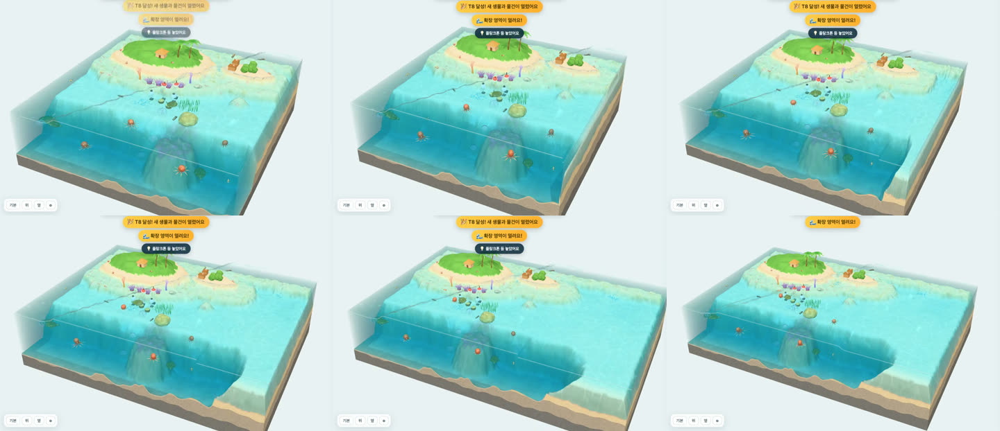

# Ocean World 3D — P2 후속 보고서(대니님 결정 세 가지 + 장식 떼)

작성 2026-11-12(UTC+5) · 브랜치 `claude/ocean-world-3d-p2b-81756e`(통합 브랜치 `claude/stoic-ramanujan-csbrar`의 `8a077da`에서 시작) · 담당: 3차 회차 하위 세션 "P2 후속"

표기: **[확인]** = 테스트·봇·브라우저에서 직접 확인함 · **[추정]** = 확인하지 않은 판단

## 0. 요약

| 할 일 | 결과 | 어떻게 확인했나 |
|---|---|---|
| 물건 개수 상한 | 🟢 본 블록 해저 120 · 수중 60 + 확장 영역 해저 40 · 수중 20(육지 없음) | 테스트 3개 추가(78개 통과), 봇 표(2절), 브라우저에서 본 블록·확장 영역을 실제로 채워 패널·놓기 안내 확인 |
| 모이는 연출 | 🟢 물건을 놓으면 가까운 헤엄 생물 최대 4마리가 4.6초 동안 다가갔다 돌아감 | 브라우저에서 놓기 → 오프셋 시간표(3절), 화면 그림 |
| 이어서 넓어지는 확장 영역 | 🟢 다시 불러오지 않고 그 자리에서 1.7초 동안 옆으로 늘어남 | 개발용 `?t8soon=1`로 T8 직전 → 물건 하나 → 녹화. 확장 구간 프레임 195~205개 중 20ms 넘는 것 0~1개 |
| 장식 떼 | 🟢 본 블록 두 떼(76마리) + 확장 영역 한 떼(36마리) | 브라우저 그림, 드로우콜 +1~2 |
| 새로고침 후 이어하기 | 🟢 T8·물건·생물이 그대로, 넓어진 블록으로 시작 | 브라우저에서 새로고침 → 타이틀 → 누르기 |
| 콘솔 오류 | 🟢 0건(`favicon.ico` 404 한 줄은 원래부터 있음) | 처음에 장식 떼가 지오메트리를 같이 써서 WebGL 경고가 났고, 고친 뒤 0건 [확인] |

> 화면 확인은 **창 없는(headless) Chrome**에서 했어요. 내장 브라우저 창이 앱에서 숨겨져 있어 페이지가 멈춘 상태(창 크기 0)였고, 창을 띄운 임시 Chrome은 대니님 화면에 떠서 바로 닫았어요. headless Chrome도 이 맥북의 실제 GPU(Apple M5, Metal)로 그려요. 마우스·트랙패드 손맛은 대니님이 직접 보셔야 해요(7절).

## 1. 만든 것

| 파일 | 내용 |
|---|---|
| `eco/atoll/data.js` | `LIMITS = { land: null, bed: 120, water: 60, ext: { land: null, bed: 40, water: 20 } }` |
| `sim/rules.js` | 상한을 본 블록(main)·확장 영역(ext)으로 따로 셈. `limitWhy(S, id, x?, y?)`(자리를 주면 그 자리의 몫), `limitInfo(S, id)`(화면 안내용), `zoneCount(S, z, area)`. `freeSpot`은 찬 몫의 자리를 건너뜀 |
| `sim/space.js` | `freeSpot`의 `opt.area: 'main' \| 'ext'` |
| `ui/hud.js` | 꾸미기 탭 구역마다 "놓을 수 있는 해저 물건 본 블록 87/120 · 확장 영역 3/40"(찬 몫은 빨강) |
| `render/proto/creatures.js` | `lure(x, y, z, { n, radius, dur })` 모이는 연출(규칙 자리 위에 얹는 오프셋) |
| `render/core/terrain.js` | `buildTerrainAsync`(같은 결과를 프레임마다 6ms씩 나눠 만듦). `buildTerrain`은 그대로 |
| `render/main.js` | 지형·좌표를 바꿔 끼울 수 있게(`terrainState`·`applyTerrain`), `growExt`(이어서 넓어지는 확장), 장식 떼, 놓은 뒤 `creatures.lure`, 개발용 `?t8soon=1`, `?schools=0`·`?school=lowpoly` |
| `tools/sim.js` | `--limits=육지,해저,수중/확장 육지,확장 해저,확장 수중`, `--limit-table`에 확장 영역 몫 후보와 "못 한 항목" 칸 |
| `test/terrain.test.js` | 상한 시험 4개(데이터 값, 몫 하나, 본 블록·확장 영역 따로, 열리기 전 안내와 저장·불러오기) |
| `DESIGN.md` 15절 | 이번에 정한 것 |
| `docs/img/p2b/` | 그림 5장(8절) |

고치지 않은 곳: `render/proto/species.js`·`props.js`·`propview.js`·`geo.js`, `eco/atoll/species/`·`terrain.js`·`profile.js`, `render/aqua/school.js`, `shaderPatches.js`, `ui/prologue*` [확인: `git diff --stat`에 없음]. `PropView`는 파일을 고치지 않고 인스턴스의 `coords`·`heightAt`만 바꿔 끼워요.

## 2. 물건 개수 상한

### 2.1 확장 영역 몫 고르기 [확인, `node tools/sim.js --limit-table 3 240 --terrain=eco/atoll/terrain.js`, 활동 플레이 시드 1~3]

| 상한 | T8 도달(분) | 240분 끝 물건 수(육지/해저/수중) | 그중 확장 영역(해저/수중) | 발전도 | 행복도 | 확장 영역 꾸미기 | 못 한 항목 |
|---|---|---|---|---|---|---|---|
| 없음 | 95~100 | 729~826 (30/287~289/412~507) | 135/129~173 | 4143~4697 | 100% | 4/6 | needs, theme |
| 해저 120 · 수중 60(몫 하나) | 95~100 | 210 (30/120/60) | 0/0 | 1882 | 100% | 2/6 | item, needs, theme, zones |
| 본 120·60 + 확장 30·15 | 95~100 | 255 (30/150/75) | 30/15 | 2047 | 100% | 4/6 | needs, theme |
| **본 120·60 + 확장 40·20(고름)** | 95~100 | 270 (30/160/80) | 40/20 | 2102 | 100% | **4/6** | needs, theme |
| 본 120·60 + 확장 60·30 | 95~100 | 300 (30/180/90) | 60/30 | 2212 | 100% | 4/6 | needs, theme |

같은 방법으로 더 작은 몫도 쟀어요: 5·3 → 4/6(발전도 1912), 10·5 → 4/6(1937), 20·10 → 4/6(1992) [확인].

읽는 법과 고른 이유
- **확장 영역 몫을 따로 두면 꾸미기 달성이 상한 없을 때와 같은 4/6으로 돌아와요.** 몫이 하나면 본 블록이 다 쓴 뒤라 확장 영역에 물건이 하나도 못 들어가 2/6이에요 [확인].
- 봇에서는 몫 크기(5·3~60·30)로 달성 수가 갈리지 않았어요. 못 한 두 항목(먹이·쉼터·맑은 물 물건, 테마 물건 2개)은 **상한이 없어도 못 해요.** 봇이 점수 효율로 물건을 골라 테마 물건(맹그로브·수상 데크)을 사지 않아서예요 [확인: 수 / 추정: 원인]. 봇은 고치지 않았어요(맡은 범위 밖의 밸런스 일).
- 그래서 넓이로 정했어요. 확장 영역은 800칸으로 본 블록(1,600칸)의 절반이라, 같은 밀도면 60·30이에요. 그보다 조금 성기게 40·20(본 블록 밀도의 2/3)을 골랐어요. 꾸미기 여섯 항목에 필요한 물건(해저 약 4 · 수중 1)의 열 배쯤이라 사람이 테마 물건을 놓을 자리는 넉넉해요 [추정].
- 240분 발전도 2,102는 Animal World 약 1,800보다 17% 높아요. 1,800에 더 맞추려면 확장 영역 몫을 5·3까지 줄여도 1,912예요. 본 블록 몫(대니님 결정)을 그대로 두는 한 이 줄이 가장 가까워요 [확인].

### 2.2 상한을 켠 뒤 티어 도달 시간 [확인, `node tools/sim.js --table 3 --terrain=eco/atoll/terrain.js`]

| 플레이 | T2 | T3 | T4 | T5 | T6 | T7 | T8 |
|---|---|---|---|---|---|---|---|
| 활동 | 0분 | 7~8 | 20~21 | 32~36 | 49~53 | 64~72 | **95~100** |
| 가끔 | 0 | 8~13 | 27~35 | 48~50 | 69~74 | 97~108 | 131~145 |
| 방치 | 7 | 39 | 65 | 94 | 129 | 168 | 220 |

P2(상한 없음)와 같아요. T8 전에 봇이 놓는 물건이 상한보다 적어서예요 [확인].

### 2.3 셈 규칙

- 물건이 덮는 칸 중 **하나라도 확장 영역이면 확장 영역 몫**이에요. 확장 영역 꾸미기(`extItems`)가 P2부터 쓰던 기준(`space.inExt`)과 같게 했어요. 이름은 "모두 확장 영역"처럼 보이지만 실제 뜻은 "걸침"이라서 주석을 바로잡았어요 [확인: 브라우저에서 x = 39에 놓인 2×2 물건이 확장 영역 몫].
- 패널 단추: 두 몫이 다 차야 막혀요. 본 블록만 차면 단추는 열려 있고 권하는 자리가 확장 영역으로 가요. 그 상태에서 본 블록을 누르면 빨간 상자와 "본 블록 수중 물건은 60개까지예요. 확장 영역에 놓아 보세요" [확인].
- 열리기 전에 본 블록이 차면 "해저 물건은 120개까지예요(T8 확장 영역에 더 놓을 수 있어요)" [확인: 테스트].
- 지형 맞추기(`fitTerrain`)는 상한을 보지 않아요(이미 산 물건을 옮기는 일).
- 봇·시험용 덮어쓰기: `makeEco(terrain, { limits: { water: 2, ext: null } })`처럼 `ext: null`이면 몫 하나로 셈.

## 3. 모이는 연출

- 물건(해저·수중)을 놓은 직후 `creatures.lure(가운데 x, y, 높이)`. 육지 물건은 부르지 않아요.
- 고르는 생물: 지난 프레임에 그린 자리에서 반경 13칸 안, 헤엄형·수면형(흰동가리·문어·거북·쥐가오리)만, 가까운 순 최대 4마리. 떠다니는 해파리와 바닥 생물은 오지 않아요. 물건까지 곧은 길이 섬·얕은 바닥(높이 −0.5칸 위)을 지나면 빼요.
- 움직임: 다가감 1.2초 → 머묾 → 돌아감 1.6초, 전체 4.6초(매끈한 곡선). 마리마다 0.18초씩 늦게 출발. 물건 둘레 고리 위에 서로 다른 자리(물건보다 0.4~1.1칸 위). 다가갈 때는 그 자리 쪽, 머무는 동안은 물건 쪽, 돌아갈 때는 움직이는 쪽을 봐요.
- **규칙은 그대로예요.** `sim/`의 자리·분포·필요는 바뀌지 않고, 화면 보간 자리에 오프셋만 얹어요. 고르기(탭)는 그려진 자리 기준이라 모인 생물을 누를 수 있어요.

브라우저에서 잰 오프셋(수중 물건, 0.7초 간격) [확인]

| 경과 | 거북 | 흰동가리 | 문어 | 흰동가리 |
|---|---|---|---|---|
| 0.7초 | 1.4칸 | 1.1 | 1.1 | 0.4 |
| 1.4초 | 2.2 | 2.7 | 5.8 | 5.8 |
| 2.8초 | 2.2 | 2.7 | 6.8 | 7.1 |
| 4.2초 | 0.3 | 0.8 | 3.4 | 4.4 |

## 4. 이어서 넓어지는 확장 영역

### 4.1 방식

```
T8 사건 ─→ ① 만들기(화면은 그대로, 프레임마다 6ms씩)
             본 블록 지형(열린 지형) · 확장 영역 지형 · 확장 영역 물(따로 높이장)
             열린 지형의 규칙 · 블록 전체 물(높이장)
        ─→ ② 바꿔 끼우기(한 프레임, 1.5ms 안팎)
             좌표를 새 블록 가운데로 → 옛 물·입자·떼·카메라를 같은 만큼 옮김(화면 그대로)
             본 블록 지형 교체(+x 가장자리 띠: 바깥 비탈 → 이어진 바다)
             확장 영역 지형·물·떼를 '판' 하나에 담아 붙는 옆면에서 폭 0으로
             판정 상자·그림자 범위·카메라 금지 상자 넓힘, 카메라는 넓어진 블록이 다 보이게 2.3초 동안 물러남
        ─→ ③ 늘어남 1.7초: 판 폭 0 → 약 1.085(넘침) → 1, 안개 상자도 같이 넓힘, 블록 출렁임
             붙는 면의 물 벽 두 장은 높이 0으로 접어 유리벽처럼 안 보이게
        ─→ ④ 마무리(3~7ms): 물을 블록 전체 하나로(물결 옮겨 담음) · 규칙을 열린 지형으로(상태 S 그대로)
             다음 프레임들에: 부유 입자·빛줄기 다시 · 저장 · "확장 영역이 열렸어요!" 안내 창
```

- 지형 정의(`eco/atoll/terrain.js`)는 바꾸지 않았어요. `atollTerrain(TER, true)`로 열린 지형 약속만 새로 만들어요.
- 다 늘어난 뒤 지형은 두 조각(본 블록 + 확장 영역)이에요. 그래서 드로우콜이 다시 불러온 경우보다 2회 많아요(23회 / 21회). 이음매는 같은 높이 함수라 보이지 않아요 [확인: 그림].
- 규칙은 다 늘어난 뒤에 열린 지형으로 바꿔요. 그래서 늘어나는 동안 생물이 아직 안 보이는 확장 영역으로 나가지 않아요.
- 재질은 옛 것을 다시 써서 셰이더를 새로 컴파일하지 않아요.

### 4.2 프레임 시간 [확인, headless Chrome · 1440×813 · 픽셀 비율 1 · vsync 60Hz]

T8 직전(`?t8soon=1`)에서 물건 하나 → T8 → 늘어남 → 마무리 1.2초 뒤까지 매 프레임을 셌어요.

| 실행 | 프레임 | 평균 | 최대 | 20ms 넘음 | 만들기(나눠서) | 바꿔 끼우기 | 마무리 |
|---|---|---|---|---|---|---|---|
| 처음 안(나누지 않음) | 175 | 17.05ms | **50ms** | 3 | 본 블록 82ms + 확장 영역 47ms 한 프레임씩 | 1.0ms | 17.8ms |
| 나눠 만들기 + 마무리 가볍게 | 202 | 16.67 | 16.8 | 0 | 246 + 138ms(6ms씩) | 1.4 | 6.7 |
| 같은 것(물 벽 접기 추가) | 205 | 16.67 | 16.8 | 0 | 283 + 155 | 1.8 | 5.0 |
| 같은 것(떼 지오메트리 복사 고친 뒤) | 201 | 16.75 | 33.3 | 1 | 259 + 145 | 1.6 | 3.7 |
| 같은 것(`?perf=1`) | 199 | 16.67 | 16.8 | 0 | 209 + 119 | 1.6 | 2.9 |

- T8 사건에서 늘어나기 시작까지 0.26~0.43초(만들기), 늘어남 1.7초.
- 33ms 한 번은 마무리 0.8초 뒤(안내 창·저장 시점)였고, 다섯 번 중 한 번만 나왔어요 [확인: 수 / 추정: 원인].

확장 연출 전후 15초 측정(성능 표시와 같은 계측, 5초 쉬고 15초) [확인]

| 장면 | fps | 최대 프레임 | 프레임당 JS(평균/95%) | 드로우콜 | 삼각형 |
|---|---|---|---|---|---|
| 견본 장면, 닫힌 블록(`?perf=1&demo=1`) | 60.0 | 16.8ms | 1.50 / 2.0ms | 20 | 251,662 |
| 견본 장면, 열린 블록(`&ext=1`) | 60.0 | 16.8 | 1.66 / 2.1 | 21 | 330,086 |
| 게임에서 그 자리에서 넓힌 뒤(`?t8soon=1&perf=1`, 생물 28) | 60.0 | 33.4(한 번) | 1.44 / 2.4 | 23 | 300,940 |

- `tools/perf-run.mjs`는 headless Chrome에서 프레임을 세지 못했어요(창 크기 조절·화면 표시를 전제로 함). 그래서 같은 값을 페이지 안에서 직접 쟀어요. 노트북 실측 보고서(창을 띄운 Chrome, 전체 화면)와 같은 조건은 아니에요. 전체 화면·픽셀 비율 2 값은 그 방식으로 다시 재야 해요 [추정: 여유는 충분, 실측 보고서 기준 기본 물 8.35ms에 지형 조각 +2회].

## 5. 장식 물고기 떼

- `render/aqua/school.js`의 `createSchool`과 `eco/atoll/species/chromis.js`의 `build`를 이름 그대로 써요(`variant: 'jelly'`, `detail: 0.6`).
- 본 블록: 칸두 위(격자 17, 11.5, 수심 5.5) 42마리, 석호 위(24, 26, 수심 3.2) 34마리 = 메시 하나. 확장 영역이 열리면 확장 영역 가운데(50, 20, 수심 4.5) 36마리 메시 하나를 더하고, 이 떼도 판에 담겨 같이 늘어나요. 본 블록 떼가 다닐 수 있는 상자도 확장 영역만큼 넓혀요.
- 떼마다 지오메트리를 복사해요. `SpeciesMesh`가 인스턴스 속성을 지오메트리에 붙여서, 같은 생성기 지오메트리를 두 떼가 같이 쓰면 앞 떼(76마리) 속성이 뒤 떼(36마리) 크기로 덮여 `glDrawElementsInstanced: Vertex buffer is not big enough` 경고가 났어요 [확인: 고친 뒤 0건]. P3 콘텐츠 세션이 `school.js`에서 같은 지오메트리를 여러 메시에 쓸 때도 같은 일이 생길 수 있어요.
- 떼는 바닥 아래로 안 내려가지만 섬을 피하지는 않아요(궤도 중심을 깊은 곳에 둠).

## 6. 개발용 주소 옵션

| 옵션 | 뜻 |
|---|---|
| `?t8soon=1` | T8 바로 앞 새 게임(생물 T7 한도 28마리, 발전도 약 838/870, 타이틀 없이). 물건을 하나 놓으면 T8 → 확장 연출. **저장을 덮어써요**(진짜 게임으로 하지 마세요) |
| `?schools=0` · `?school=lowpoly` | 장식 떼 끄기 · 로우폴리풍 |

## 7. 확인함 / 추정

| 확인함 | 추정 |
|---|---|
| `npm test` 78개 통과 | 확장 영역 몫 40·20이 사람 플레이에서 적당한지(봇이 테마 물건을 안 사서 갈리지 않음) |
| 봇 표 2.1·2.2절 | 240분 발전도 2,102가 "Animal World 1,800과 비슷한 줄"로 충분한지 |
| 경계: `sim/`에 Three.js·DOM·생태계 이름 없음, `render/core`가 `render/aqua`를 import 안 함 | 33ms 한 번의 원인(안내 창·저장 시점) |
| 브라우저: 놓기 → 모이는 연출, 상한(본 블록 60/60 → 확장 영역 권함, 둘 다 차면 단추 막힘), T8에서 그 자리에서 넓어짐, 새로고침 후 이어하기(T8·물건 21·생물 28, 생물 2마리 이미 확장 영역에) | 창을 띄운 Chrome·전체 화면에서도 확장 구간이 끊기지 않는지(4.2절 조건 차이) |
| 확장 구간 20ms 넘는 프레임 0~1개, 콘솔 오류 0건 | 모이는 연출의 거리·시간(4마리, 4.6초)이 보기 좋은지 |

## 8. 그림 `docs/img/p2b/`

| 파일 | 내용 |
|---|---|
| `p2b-lure.jpg` | 왼쪽: 묘목 줄을 놓기 직전(초록 상자) · 오른쪽: 놓은 뒤 1.7초, 거북 두 마리가 다가옴 |
| `p2b-grow-strip.jpg` | T8에 그 자리에서 넓어지는 장면 6컷(0.2~0.4초 간격, 오른쪽에서 확장 영역이 자람) |
| `p2b-t8-after.jpg` | 다 넓어진 뒤(안내 창) |
| `p2b-limit-main.jpg` | 본 블록 수중 60/60: 본 블록 자리는 빨간 상자와 "확장 영역에 놓아 보세요" |
| `p2b-limit-full.jpg` | 본 블록 60/60 · 확장 영역 20/20: 수중 물건 단추가 모두 막히고 이유 한 줄 |



## 9. 대니님이 직접 봐야 할 것

- **넓어지는 연출의 느낌**: 개발용 `http://localhost:<포트>/?t8soon=1`에서 물건 하나를 놓으면 돼요. 1.7초가 짧거나 긴지, 넘침(약 8%)과 출렁임이 기분 좋은지, 카메라가 물러나는 게 괜찮은지. 이 주소는 저장을 덮어써요.
- **모이는 연출**: 물속에 물건을 놓았을 때 생물이 다가오는 게 눈에 띄는지, 너무 많이·오래 오지 않는지(지금 4마리·4.6초).
- **상한 안내**: 꾸미기 탭 위의 "본 블록 n/120 · 확장 영역 n/40" 줄과 막힘 문구가 이해되는지.
- **장식 떼**: 젤리풍 떼가 생물(젤리풍)과 어울리는지. `?school=lowpoly`와 비교.

## 10. 남은 것·후속 제안

| 항목 | 내용 |
|---|---|
| 봇의 테마 물건 | 봇이 맹그로브·수상 데크를 사지 않아 확장 영역 꾸미기가 4/6에서 멈춰요. 봇에 "확장 영역 꾸미기 항목 채우기" 단계를 넣으면 확장 영역 몫을 봇으로 가를 수 있어요(밸런스 일) |
| 새로 시작(T8 세이브에서) | 여전히 다시 불러오기로 닫힌 지형에 돌아가요(이번 범위 밖). 같은 방식으로 그 자리에서 줄이는 연출도 만들 수 있어요 |
| `inExt` 이름 | 뜻은 "확장 영역에 걸침"이에요. 이름을 바꾸면 확장 영역 꾸미기 쪽도 함께 바뀌어 손대지 않았어요 |
| 노트북 실측 | 창을 띄운 Chrome·전체 화면에서 `tools/perf-run.mjs`로 확장 연출 전후를 다시 재면 실측 보고서와 같은 조건이 돼요 |
| treemap | 서비스 위치·구성 변화는 없어요(게임 안 기능). 갱신 필요 없음 |
