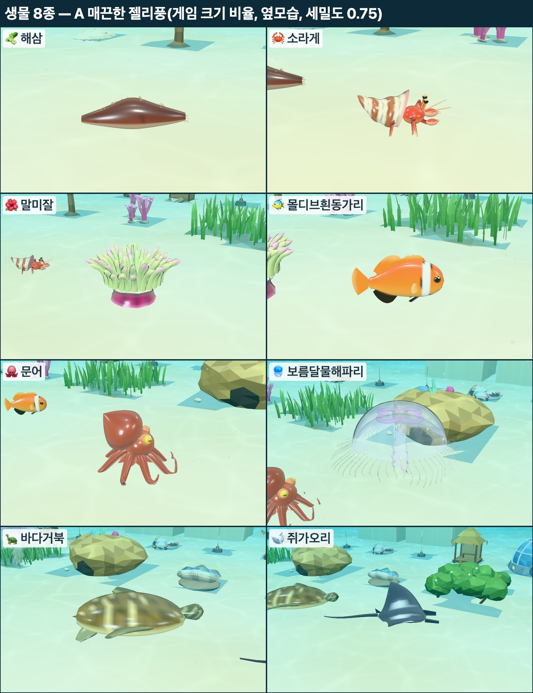
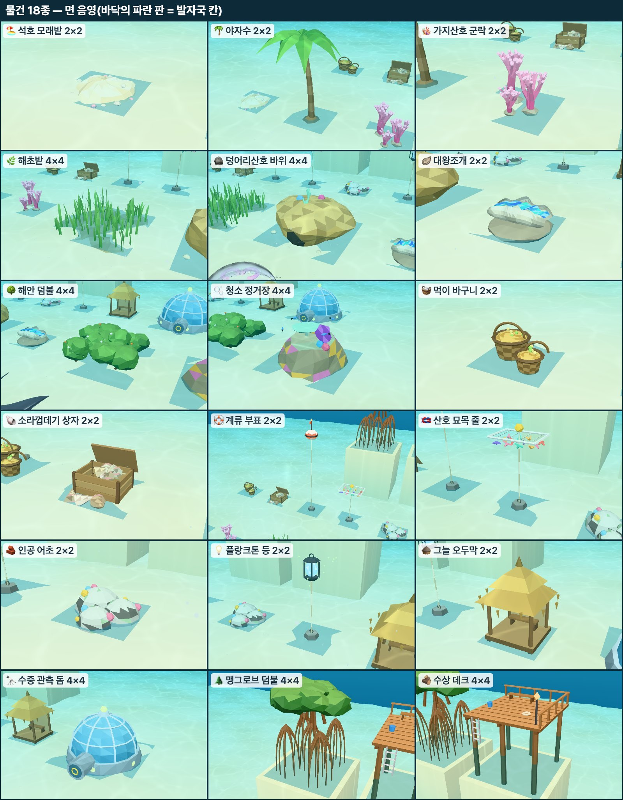
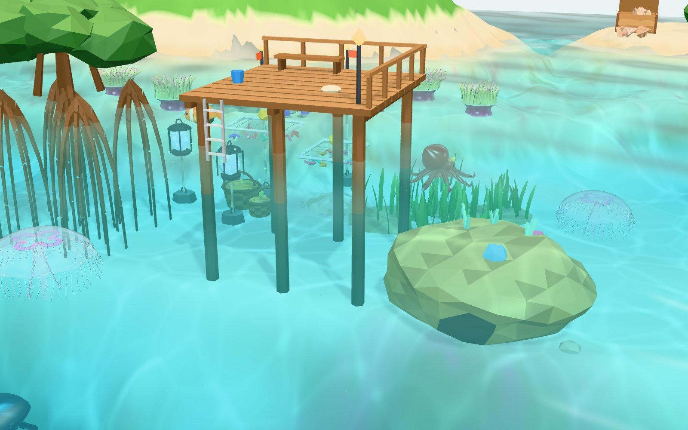

# Ocean World 3D — P3 콘텐츠 보고서

작성 2026-11-12(UTC+5) · 브랜치 `claude/ocean-world-3d-p3-content-c2b9a9`(통합 브랜치 `8a077da`에서 시작) · 담당: 3차 회차 하위 세션 "P3 콘텐츠"

PLAN.md 4.1절 P3 — 생물 8종과 물건 18종(자연물 8 · 인공물 8 · 확장 영역 테마 2)을 정해진 화풍(PLAN 0절 2026-11-12 "섞기": 생물 A 매끈한 젤리풍, 물건 면 음영)의 코드 생성기로 만들고, 게임 화면의 임시 도형을 바꿨어요.

표기: **[확인]** = 이 맥북(MacBook Air 15 M5)에서 실행해 보거나 쟀음 · **[추정]** = 실행하지 않은 판단

## 0. 요약

- **생물 8종**을 A 매끈한 젤리풍으로, **물건 18종**(자연물 8 · 인공물 8 · 테마 2)을 면 음영으로 코드 생성기에 만들고, 게임 화면의 P1 임시 도형을 모두 바꿨어요 [확인: 게임 견본 장면·새 게임에서 들이기 8종·놓기 19개].
- `render/proto/`의 네 파일이 내보내는 이름·모양은 그대로예요(`SPECIES`·`speciesMaterial`·`scaleCounts`·`parseSizeScale`·`propGeometries`·`PropView` 공개 메서드). `creatures.js`·`main.js`는 고치지 않고 그대로 돌아요 [확인].
- **성능**: 견본 장면(생물 44 · 물건 21) 프레임당 **노트북 창 5.07 → 5.66ms(+0.59)**, **전체 화면 8.11 → 9.00ms(+0.89, 60fps 예산의 54%)**, **드로우콜 19회 그대로**(목표 300 이하), 삼각형 22.3만 → 38.9만 [확인: vsync 끔, 전·후 번갈아 두 번씩]. 기본 물 60fps 유지 [추정: 프레임 비용이 예산 안이라서, vsync 켠 측정은 안 함].
- `npm test` 75개 통과, 게임·갤러리 콘솔 오류 0건 [확인].
- 생물 세밀도는 **0.75**로 두었어요(1 대비 삼각형 약 30% 적음). `?spdetail=` 주소 옵션으로 바꿔 볼 수 있어요.
- 대니님이 보실 것: 생김새(7절 그림), 특히 해삼·소라게·문어·거북 모양과 물건 크기감.

## 1. 만든 것

```
games/ocean-world-3d/
  eco/atoll/species/   seacucumber · hermitcrab · anemone · octopus · greenturtle · manta (새로 6종)
                       clownfish · moonjelly (P3 화풍 샘플 그대로, 게임은 A 젤리풍 사용) · _kit.js · chromis.js (그대로)
  eco/atoll/props/     _kit.js (면 음영 도구) · _mooring.js (닻 덩이·밧줄)
                       lagoonsand · palm · branchcoral · seagrass · boulder · giantclam · beachscrub · cleaning (자연물 8)
                       feedbasket · shellbox · buoy · nursery · reefblock · planktonlamp · hut · dome (인공물 8)
                       mangrove · boardwalk (확장 영역 테마 2)
  render/proto/species.js   SPECIES가 생성기를 감쌈(내보내는 이름·모양 그대로)
  render/proto/props.js     propGeometries()가 생성기 18종을 모음(+ recipes·info 필드)
  render/proto/propview.js  조각 배치표 RECIPES를 생성기에서 읽음(공개 메서드 그대로)
  render/proto/geo.js       머리말만 고침(render/main.js가 rng를 씀)
  tools/gallery.html, gallery.js   전체 줄 세우기 보기(mode=all), 가까이 보기 판(__cap.sheet)
  docs/p3-content-report.md, docs/img/p3c/
```

고치지 않은 곳(맡지 않은 파일): `sim/`, `eco/atoll/data.js`, `render/main.js`, `render/proto/creatures.js`, `render/core/`(`shaderPatches.js` 포함 — 새 조각은 생성기가 기존 훅으로 넣어서 고칠 필요가 없었음), `render/aqua/`(`school.js`·`waterFog.js` 포함), `ui/`, `index.html`, `test/` [확인: `git diff --stat`].

## 2. 생물 8종(A 매끈한 젤리풍)

생성기 약속은 P3 화풍 샘플과 같아요(`docs/p3-art-report.md` 2절): `build(THREE, { variant, detail })` → `{ geometry, material: { type, params, renderOrder }, deform, shade, info }`. 크기·속도·개체 수는 받지 않아요(정본 `eco/atoll/data.js`, 화면은 `len × SIZES.draw`를 인스턴스 배율로 곱함). 재질은 모두 `MeshPhysicalMaterial` + 클리어코트 + 광택(sheen) + 프레넬 림 발광(`shadePatch`), 해파리만 반투명.

| 종 | 생김새 한 줄 | 움직임(꼭짓점 셰이더) | 삼각형(몸 1개, 세밀도 1 / 게임 0.75) |
|---|---|---|---|
| 해삼 | 짙은 적갈색 소시지 몸, 등에 끝이 크림색인 뭉툭한 돌기 26개, 납작하고 밝은 배, 입 둘레 짧은 촉수 왕관 | 머리 → 꼬리로 굵기 파동(연동 운동), 걸을 때 커지고 멈추면 숨 쉬듯 작게, 고개 좌우, 입 촉수 오므렸다 폄 | 3,628 / 2,836 |
| 소라게 | 나선 골이 진 크림·갈색 줄무늬 소라껍데기, 입구의 분홍 진주층, 붉은 몸, 오른쪽이 큰 집게, 걷는 다리 세 쌍, 자루 끝 검은 눈, 긴 더듬이 | 걸을 때 다리 짝·홀 번갈아 들기 + 껍데기 좌우 흔들림·통통 튐, 멈춰도 집게 까딱·더듬이 흔들기 | 4,356 / 3,347 |
| 말미잘 | 진분홍~자주 몸통, 넓은 입판과 가운데 입, 뭉툭한 연두 촉수 74개(끝이 크림·분홍) 네 겹 | 촉수마다 해류에 흔들림 + 몇 초에 한 번 오므렸다 피는 숨쉬기, 몸통이 살짝 부풂 | 6,832 / 5,790 |
| 몰디브흰동가리 | (샘플 A 그대로) 흰 머리 띠 하나, 검은 배·뒷지느러미, 큰 눈 | 꼬리 흔들기·가슴지느러미 젓기·지느러미 물결 | 3,528 / 2,366 |
| 문어 | 위·뒤로 부푼 외투막, 얼룩무늬, 금빛 눈에 가로 눈동자, 끝이 말린 팔 8개(아래는 밝은 빨판 줄), 팔 사이 막 | 분사 박자로 팔이 모였다 펼쳐짐 + 팔마다 끝으로 지나가는 물결, 외투막 숨쉬기·분사 때 부풂 | 4,776 / 3,668 |
| 보름달물해파리 | (샘플 A 그대로) 납작한 갓, 네 잎 클로버 생식소, 짧은 술 72가닥 | 박동·촉수 뒤처짐 | 10,256 / 6,900 |
| 바다거북 | 낮은 눈물방울 등딱지(가운데 5장 + 양옆 4장 판, 판마다 퍼지는 줄무늬), 연노랑 배딱지, 비늘 테두리 머리와 짧은 부리, 긴 날개 앞지느러미 | 앞지느러미 크게 날갯짓(위아래 + 뒤로 젓기, 끝이 늦게 따라옴), 뒷지느러미 작게, 머리 끄덕임 | 3,484 / 2,200 |
| 쥐가오리 | 마름모 날개(앞 가장자리 뒤로 휨), 검은 등과 어깨의 흰 반달 무늬, 흰 배의 검은 점, 앞으로 뻗은 머리지느러미 두 장, 짧은 꼬리 | 날개가 몸 쪽에서 끝으로 파동을 보내는 날갯짓, 머리지느러미 말렸다 폄, 꼬리 좌우 | 1,564 / 1,150 |

- 몸 규칙: 앞 +Z, 위 +Y. 원점은 바닥 종(해삼·소라게·말미잘·문어)이 바닥, 헤엄 종이 몸 중심, 해파리가 갓 가장자리 평면이에요. `render/proto/creatures.js`의 높이 처리(`half`)를 바꾸지 않아도 맞게 정했어요 [확인: 게임 화면에서 묻히거나 뜨지 않음].
- 해삼·소라게는 `walk: true`라 `creatures.js`가 걷는 중(aParams.y)을 채우고, 그 값으로 다리·연동 운동 크기가 바뀌어요.
- 화풍 샘플의 B 로우폴리풍은 흰동가리·해파리 생성기에 그대로 남아 있어요(갤러리 비교용). 게임은 A만 써요.

## 3. 물건 18종(면 음영)

생성기 약속(`eco/atoll/props/_kit.js` 머리말): `build(THREE, { w, h })` → `{ id, geometries: { 이름: 지오메트리 }, recipe: [조각], info }`. 발자국 칸 수는 `render/proto/props.js`가 `data.js ITEMS`에서 읽어 넘겨요. 조각(`recipe`)의 뜻은 P2 `propview.js`의 표와 같아요(`dx·dy` 발자국 안 자리, `at: ground|item|sea`, `up` 세로로 늘리기, `z` 수면 기준 높이, `float` 수면 기울기). 4×4 물건은 발자국을 거의 채우게 만들고, 바닥이 기울 수 있는 것(해초밭·해안 덤불·맹그로브 뿌리)은 조각을 나눠 조각마다 지형에 얹어요(`docs/p2-report.md` 9절의 "4×4가 작아 보임"에 대한 답).

게임 재질(`render/main.js`의 `propMat`, 바꾸지 않음)은 면 음영 + `aAux`(흔들림·발광)라, 생성기는 꼭짓점 색·`aAux`만 정해요. 잎·판처럼 얇은 것은 양면이 보이게 뒤집힌 삼각형을 하나 더 넣었어요(재질이 앞면만 그림).

| 물건 | 칸 | 생김새 한 줄 | 움직임·빛 | 삼각형(놓인 1개) |
|---|---|---|---|---|
| 석호 모래밭 | 2×2 | 흰 모래 둔덕에 진한 물결 자국, 가장자리를 두른 자갈·분홍 산호 부스러기, 조개 3개·주황 불가사리 | — | 약 0.5k |
| 야자수 | 2×2 | 바다 쪽으로 휜 마디진 줄기, 가운데 골로 접힌 잎 9장, 코코넛 송이, 뿌리 둔덕(3가지) | 잎 끝 흔들림 | 약 0.8k |
| 가지산호 군락 | 2×2 | 사슴뿔처럼 갈라지는 가지 덩이 3개 + 밑동 바위, 분홍·보라·주황 중 하나 | 가지 끝 흔들림·살짝 빛남 | 약 3.4~3.9k |
| 해초밭 | 4×4 | 끈 모양 잎 덤불 5개가 발자국을 채움(조각마다 지형에 얹음), 잎 사이로 진한 바닥 | 잎 끝 흔들림 | 약 4.6k |
| 덩어리산호 바위 | 4×4 | 발자국을 거의 채우는 뇌산호 바위(홈 줄무늬), 앞쪽 아래 어두운 굴(문어 집), 위의 작은 산호 | — | 약 0.5k |
| 대왕조개 | 2×2 | 굵은 물결 주름 껍데기 두 장이 위로 벌어지고, 사이로 파랑·청록 외투막(2가지) | 외투막 빛남 | 약 1.2k |
| 해안 덤불 | 4×4 | 둥근 잎 뭉치 덤불 다섯 무더기, 흰 꽃·주황 열매 | 잎 끝 조금 흔들림 | 약 2.8k |
| 청소 정거장 | 4×4 | 위가 평평한 산호 언덕(분홍·노랑 덧붙이), 탁자산호·보라 부채산호·해면, 언덕 위를 맴도는 청소놀래기 4마리 | 부채산호·물고기 흔들림 | 약 0.4k |
| 먹이 바구니 | 2×2 | 띠가 번갈아 진한 엮은 바구니 두 개, 손잡이, 소복한 먹이 알갱이, 밧줄과 돌 추 | 먹이 살짝 빛남 | 약 1.2k |
| 소라껍데기 상자 | 2×2 | 널빤지 상자(틈 사이로 안이 보임), 뒤에 기댄 뚜껑, 안과 앞 모래에 소라껍데기 9개 | — | 약 0.7k |
| 계류 부표 | 2×2 | 흰 바탕 주황 띠 부표, 표지 막대·깃발·노란 등, 바닥 닻 덩이까지 밧줄 | 수면에 떠서 기울어짐, 등 빛남 | 약 0.3k |
| 산호 묘목 줄 | 2×2 | 흰 관 네모 틀에 줄 4가닥 × 알록달록 산호 조각, 위의 노란 부이, 밧줄·닻 | 산호 조각 흔들림·빛남 | 약 0.9k |
| 인공 어초 | 2×2 | 구멍 뚫린 콘크리트 반구(리프볼) 셋, 이끼빛 얼룩, 붙은 작은 산호 | — | 약 0.5k |
| 플랑크톤 등 | 2×2 | 육각 철제 틀 안에서 빛나는 하늘색 심지, 위아래 뚜껑·고리, 둘레의 빛 알갱이, 밧줄·닻 | 심지·알갱이 빛남, 알갱이 흔들림 | 약 0.4k |
| 그늘 오두막 | 2×2 | 띄운 나무 마루, 기둥 4개, 두 겹 초가 지붕과 처마 술, 뒷벽·의자 | 처마 술 흔들림 | 약 0.3k |
| 수중 관측 돔 | 4×4 | 둥근 콘크리트 받침(노란 둥근 창), 금속 갈비뼈 유리 돔, 꼭대기 표지등, 앞으로 나온 출입 관과 노란 손잡이 문 | 창·등·유리 빛남 | 약 1.1k |
| 맹그로브 덤불 | 4×4 | 바닥에서 활처럼 휜 버팀뿌리 다발 5개(수면 위 0.45칸까지 세로로 늘림), 줄기 5개, 짙은 잎 뭉치 덤불과 노란 잎 | 잎 흔들림 | 약 2.5k |
| 수상 데크 | 4×4 | 바닥에 박은 나무 기둥 6개(아래는 이끼빛, 데크 높이까지 늘림), 널빤지 데크, 두 면 난간, 벤치, 등불 기둥, 물로 내려가는 사다리, 밧줄·물통 | 등불 빛남 | 약 0.7k |

## 4. 게임에 붙이기

| 파일 | 바뀐 것 | 내보내는 이름·모양 |
|---|---|---|
| `render/proto/species.js` | P1 임시 도형 8개를 지우고, 종마다 생성기를 감싼 항목(`entry`)으로 바꿈. `build()`는 생성기 지오메트리 사본, `patches`는 생성기 `deform + shade`, `mat`은 생성기 재질 값(해파리 `transparent` → `creatures.js`가 renderOrder 3). `speciesMaterial(sp)`는 `{ material, patches: [DEF_COMMON, SQUASH, ...deform, ...shade] }`(`kitMaterial`과 같은 순서) | `SPECIES`(id·count·build·patches·walk·mat), `speciesMaterial`, `scaleCounts`, `parseSizeScale` 그대로 [확인: `creatures.js`·`main.js` 그대로 돎] |
| `render/proto/props.js` | P1 임시 도형을 지우고 생성기 18종을 모음. 이름은 `<물건 id>.<조각>` | `propGeometries()` → `{ names, geometries, index }` 그대로 + `recipes`·`info` 더함, `propRecipes()` 새로 |
| `render/proto/propview.js` | 임시 표 `RECIPES`를 `propRecipes()`로 바꿈. 표가 없는 물건은 아무것도 그리지 않음(전에는 어초 모양으로 대신) | `PropView`의 생성자 인자·`sync`·`update`·`pickList`·`count` 그대로 |
| `render/proto/geo.js` | 머리말만 | 그대로(`main.js`가 `rng`를 씀) |

- 셰이더 조각은 생성기가 기존 훅(`vertexPars`·`vertexNormal`·`vertexDeform`·`fragmentEmissive`·`fragmentOutput`)으로 넣어서 `shaderPatches.js`는 고치지 않았어요 [확인: 게임·갤러리 콘솔 오류 0].
- `render/aqua/school.js`는 손대지 않았어요. 장식 떼를 게임 블록에 넣는 일은 `main.js` 몫이라 이번 범위 밖이에요.

## 5. 성능 — 바꾸기 전 · 후 [확인]

- 방법: `tools/perf-run.mjs`(실측 세션 도구)로 측정 전용 Chrome 157(임시 프로필, `--disable-gpu-vsync --disable-frame-rate-limit`)에서 `?perf=1&demo=1`(견본 장면: T8, 생물 44마리, 물건 종류마다 1~2개 = 21개)을 12초씩 쟀어요. **바꾸기 전**은 통합 브랜치 커밋 `8a077da`를 임시 폴더에 풀어 따로 서버를 띄웠고, 전·후를 **번갈아 두 번씩** 쟀어요(같은 조건 두 번의 차이 0.1ms 이하).
- 이 맥북: MacBook Air 15(M5), DPR 2, 전원 연결. 노트북 창 1280×800(캔버스 2560×1426), 전체 화면 캔버스 3420×1970. 실측 세션 보고서와 같은 조건이에요.

| 조건 | 창 | 바꾸기 전 ms(fps) | 바꾼 뒤 ms(fps) | 차이 | 드로우콜 | 삼각형 전 → 후 | 콘솔 오류 |
|---|---|---|---|---|---|---|---|
| 견본 장면 | 노트북 창 | 5.07 (197) | **5.66 (177)** | +0.59 | 19 → 19 | 22.3만 → 38.9만 | 0 |
| 견본 + 확장 영역 `ext=1` | 노트북 창 | 5.22 (191) | 5.71 (175) | +0.49 | 19 → 19 | 28.7만 → 45.4만 | 0 |
| 견본 장면 | 전체 화면 | 8.11 (123) | **9.00 (111)** | +0.89 | 19 → 19 | 22.3만 → 38.9만 | 0 |
| 견본 + 확장 영역 | 전체 화면 | 8.28 (121) | 8.92 (112) | +0.64 | 19 → 19 | 28.7만 → 45.4만 | 0 |

어디서 늘었나(노트북 창, 같은 시간대에 번갈아 잰 값):

| 실험 | 바꾸기 전 | 바꾼 뒤 | 해석 |
|---|---|---|---|
| 생물 0마리 `n=0`(물건·지형·물만) | 5.18ms · 14.9만 | 5.72ms · 17.9만 | 물건 18종 모양 몫 약 +0.5ms |
| 생물 세밀도 1 → 0.5 `spdetail` | — | 1: 7.2 / 5.9ms · 0.5: 6.5 / 5.3ms(두 번) | 세밀도 0.5가 0.5~0.7ms 싸요. 기본은 중간인 **0.75** |

- 도중에 다른 세션의 봇(`tools/sim.js`)이 CPU를 쓰던 시간대가 있어 그때 잰 값(전 7.3 / 후 8.9ms 등)은 표에 넣지 않았어요. 위 표는 그 뒤 조용한 상태에서 번갈아 잰 값이에요.
- **목표**: 기본 물 60fps 유지 — 바꾼 뒤 가장 무거운 전체 화면도 프레임 비용 9.0ms로 예산 16.7ms의 54%예요 [확인: 비용 / 추정: vsync 켠 60fps는 실측 세션 결과(8.35ms → 60fps)와 같은 줄로 판단]. 드로우콜 300회 이하 — 19회 [확인].
- 물건을 많이 놓은 후반(해저 120 · 수중 60)은 재지 않았어요. 해초밭(4.6k)·가지산호(3.4~3.9k)가 많으면 삼각형이 크게 늘 수 있어요(8절) [추정].

## 6. 갤러리 `tools/gallery.html`

```bash
cd games/ocean-world-3d && python3 -m http.server 8000
```

- `http://localhost:8000/tools/gallery.html?mode=all` — **전체 줄 세우기**: 앞줄 생물 8종(게임 크기 비율 `len × SIZES.draw`), 뒤로 자연물 8 · 인공물 8 · 테마 2. 물건 밑의 파란 판이 발자국 칸이에요. 수중 물건은 바닥 위 3칸, 부표는 수면, 테마 물건(수심 3칸까지)은 얕은 받침 위에 세워요.
- 시점 단추: 전체 · 생물 8종 · 자연물 · 인공물 · 테마. 주소 `view=<종 id>` 또는 `view=<물건 id>`로 하나만 가까이 볼 수 있어요.
- 녹화 모드(`&capture&size=1600x1000&turn=0`)의 `__cap.sheet(ids, { cols, title })`가 가까이 보기 여러 장을 격자 한 장으로 이어요. `__cap.ids()`가 종·물건 id 목록, `__cap.setYaw(라디안)`이 생물 방향 고정이에요.
- 화풍 비교(`mode=lineup`·`crowd`)는 그대로 두고, P1 임시 도형 칸만 뺐어요(P1 도형을 지웠으므로).

## 7. 그림 `docs/img/p3c/` [확인]

| 파일 | 내용 |
|---|---|
| `p3c-species-sheet.jpg` | 생물 8종 가까이 보기(게임 크기 비율, 옆모습, 세밀도 0.75) |
| `p3c-props-sheet.jpg` | 물건 18종 가까이 보기(바닥의 파란 판 = 발자국 칸) |
| `p3c-gallery-all.jpg` | 갤러리 전체 줄 세우기 한 장 |
| `p3c-motion-<종>.jpg` | 움직임 띠 5장(0.18초 간격): 소라게 걷기, 문어 분사, 거북 날갯짓, 쥐가오리 날갯짓, 말미잘 흔들림, 해삼 연동 |
| `p3c-game-default.jpg` · `-side.jpg` · `-near.jpg` · `-close.jpg` | 게임 녹화 모드 견본 장면(생물 44 · 물건 21): 기본 시점, 옆, 수면 가까이, 데크·맹그로브·바위 가까이 |
| `p3c-play-adopt-place.jpg` | 새 게임에서 8종 들이기 + 물건 놓기 뒤의 실제 플레이 화면(HUD 포함, 내장 브라우저) |





확인 방법(정직하게)
- 게임: 내장 브라우저에서 새 게임을 시작해(타이틀 실제 클릭, `?prologue=0`) `__ow.game.adopt`로 8종을 들이고, 물건 18종은 규칙 함수(`G.placeItem`)로, 대왕조개 하나는 놓기 흐름(`game.startPlace` → `confirmPlace`)으로 놓았어요. 콘솔 오류 0건. 끝나고 그 브라우저의 저장(localStorage)을 지웠어요.
- 녹화 모드 그림은 `?capture&size=1600x1000`에서 `__cap.step`으로 4초 흘린 뒤 찍었어요. 그림 저장은 세션 임시 폴더의 작은 PUT 서버로 했고(저장소에 넣지 않음) 끝나고 내렸어요.
- 실시간 움직임의 느낌(매끄러운지, 과하지 않은지)은 정지 그림·띠로만 봤어요 [추정].

## 8. 알려진 문제·남은 것

| 항목 | 내용 | 근거 |
|---|---|---|
| 물건 회전과 4×4 조각 | 4×4 물건(해초밭·해안 덤불·맹그로브)은 조각마다 지형에 얹지만, 한 조각 안(2칸 폭)에서는 기울기를 따르지 않아요. 비탈 가장자리에서 조금 뜨거나 묻힐 수 있어요 | [추정] 견본 장면에서는 눈에 띄지 않음 |
| 맹그로브 뿌리·데크 기둥 길이 | 바닥에서 정해진 높이(뿌리 수면 위 0.45칸, 데크 0.9칸)까지 세로로 늘리므로, 깊은 곳(수심 3칸)일수록 뿌리가 길고 가늘어 보여요 | [확인] 갤러리(받침 2.4칸)·게임 견본 장면 |
| 많이 놓았을 때의 삼각형 | 해초밭(약 4.6k)·가지산호(약 3.4~3.9k)가 가장 무거워요. 해저 상한 120개를 모두 해초밭으로 채우면 물건만 약 55만 개예요 | [추정] 계산 |
| 반투명 겹침 | 해파리는 여전히 종 하나 = InstancedMesh 하나라 개체끼리 앞뒤 정렬이 안 돼요(샘플과 같음) | [확인] 코드 |
| 장식 떼 | `render/aqua/school.js`는 갤러리에서만 써요. 게임 블록에 넣는 건 `main.js` 몫이에요 | [확인] 코드 |
| 특수 행동 연출 | 포착용 특수 행동(해삼 늘였다 오므리기, 말미잘 확 오므리기, 문어 색 바꾸기 등)은 아직 없어요. 지금 움직임은 평소 동작뿐이에요(P4) | [확인] |

## 9. 제안(이번에 바꾸지 않음)

- **해파리 촉수 길이**: 지금 짧은 술(실제와 비슷)이라 게임 기본 시점에서는 거의 안 보여요. 움직임을 보이려면 `moonjelly.js`의 술 길이를 1.5배쯤으로 늘리는 안이 있어요.
- **생물 물속 안개 배율**: 깊은 곳 생물의 색이 많이 빠져요(바다거북·문어가 청록으로 보임, `p3c-game-near.jpg`). 생물 재질만 안개를 0.6배 정도로 받게 하는 손잡이(`waterFog.js`)가 있으면 젤리 색이 살아요.
- **장식 떼 넣기**: 석호·칸두의 열린 물 위에 푸른자리돔 떼 2개(76마리, 드로우 +1)를 `main.js`에서 붙이는 일.

## 10. 대니님이 봐야 할 것

> 생김새는 숫자로 판단할 수 없어서 대니님 눈이 필요해요. `p3c-species-sheet.jpg`·`p3c-props-sheet.jpg`·`p3c-game-close.jpg` 세 장이면 대부분 보여요.

- **해삼**: 옆에서 보면 길쭉한 마름모꼴에 가까워요. 더 통통한 소시지가 좋은지.
- **소라게**: 껍데기가 몸보다 크고 뒤로 뾰족해요(실제 소라게 비율). 껍데기를 더 둥글게 할지.
- **문어**: 외투막을 크고 둥글게, 눈을 크게 했어요(귀여운 쪽). 실제 문어처럼 작은 눈이 좋은지.
- **바다거북**: 등딱지 판 경계를 밝은 줄로 보이게 했어요. 깊은 곳에서는 물빛에 묻혀 청록으로 보여요(9절 안개 배율 제안).
- **물건 크기감**: 4×4 물건(바위·돔·해초밭·덤불·맹그로브·데크)이 발자국을 채우는지, 2×2 오두막·야자수가 섬에서 너무 크거나 작지 않은지.
- **실시간 움직임**: 소라게 걸음, 문어 분사, 거북·쥐가오리 날갯짓, 말미잘 숨쉬기의 속도·크기.

다음 단계
1. 생김새 확인 뒤 고칠 종·물건만 골라 다듬기 (추천)
2. 장식 떼를 게임 블록에 넣기(`main.js` 몫, P2 후속과 맞춰서)
3. 특수 행동(포착) 연출 — P4와 함께
