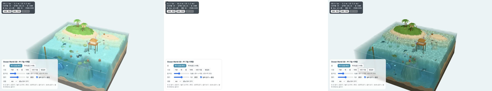
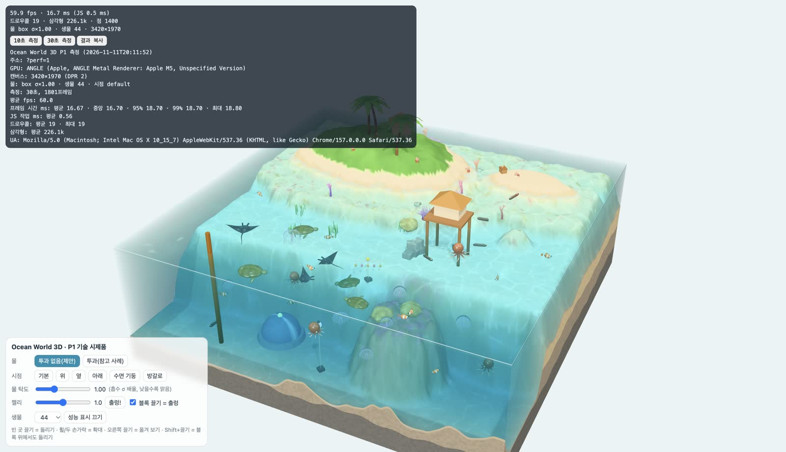
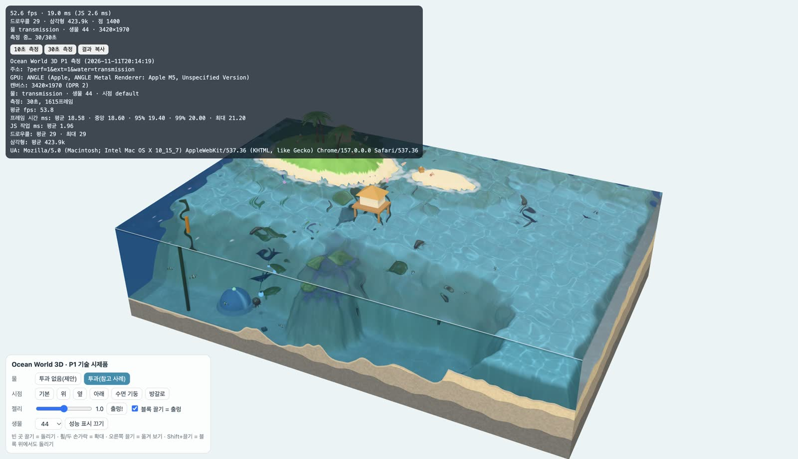

# Ocean World 3D — P1 시제품 노트북 실측 보고서

작성 2026-11-12 · 2차 사이클 실측 하위 세션(브랜치 `claude/ocean-world-3d-perf-824f77`) · 대상: 메인 세션, 대니님
측정 대상: 1차 P1 시제품(커밋 `75b2b22` 기준 `games/ocean-world-3d/`). 게임 코드는 고치지 않았어요.

## 표기

| 표기 | 뜻 |
|---|---|
| **[확인]** | 이 노트북에서 직접 재거나 화면으로 확인했어요 |
| **[추정]** | 측정에서 끌어낸 제 판단이에요. 그 자체를 재지는 않았어요 |

## 0. 요약

- **기본 물(투과 없음)은 모든 조합에서 60fps를 지켜요** [확인]. 노트북 창·전체 화면, 44마리·200마리, 확장 영역(`ext=1`) 모두 30초 동안 20ms를 넘는 프레임이 0개였어요. 화면이 60Hz라 60fps가 상한이에요.
- 여유: vsync를 끄고 재면 전체 화면(캔버스 3420×1970)에서 기본 물이 프레임당 **8.35ms**예요. 60fps 예산 16.7ms의 **50%**만 써요 [확인].
- **투과 방식은 비용이 약 2.1배**예요(전체 화면 17.7ms). 전체 화면에서 60fps에 겨우 걸리고, 확장 영역까지 열면 **53.8fps로 떨어져요** [확인].
- 가장 비싼 것은 **픽셀 수**와 **커스틱**이에요. 픽셀 비율을 2 → 1로 낮추면 8.35 → 3.15ms, 커스틱을 끄면 8.35 → 5.77ms(−2.6ms, 전체의 31%)예요. 물속 안개 −0.3ms, 그림자 −1.3ms, 생물 변형·부유 입자·생물 44마리는 측정 오차 안이에요. 수면 파동(CPU)은 0.1~0.25ms예요 [확인].
- 드로우콜은 기본 19회, 투과 29회로 목표(300회)의 6~10%예요 [확인].
- WebGL 컨텍스트를 일부러 잃었다가 되살리면 장면이 정상으로 다시 그려져요. 콘솔 오류는 전 측정에서 0건이었어요 [확인].
- 판정: **D4 유지, D5 유지, D8 유지**(7절). 다만 D8에 "전체 화면·픽셀 비율 2에서도"라는 조건을 붙이면 커스틱이 다음 비용 관리 대상이에요.

## 1. 측정 환경 [확인]

| 항목 | 값 |
|---|---|
| 기기 | MacBook Air 15(모델 `Mac17,4`), Apple M5(CPU 10코어: 성능 4 + 효율 6, GPU 10코어), 메모리 24GB |
| OS | macOS 26.5.2(25F84) |
| 전원 | 전원 어댑터 연결(배터리 74%, 충전 안 함). 열 경고 기록 없음(`pmset -g therm`) |
| 화면 | 내장 Liquid Retina, 논리 해상도 1710×1107, **devicePixelRatio 2**, 60Hz(vsync 상태에서 모든 측정의 중앙 프레임 시간 16.70ms) |
| 브라우저 | Google Chrome **157.0.8103.39**(측정 전용 임시 프로필, 확장 프로그램 없음) |
| WebGL | `ANGLE (Apple, ANGLE Metal Renderer: Apple M5, Unspecified Version)`, WebGL2, `WEBGL_multi_draw` 있음(물건 `BatchedMesh` 1회 호출 유지) |
| 렌더러 픽셀 비율 | 2(코드가 `min(devicePixelRatio, 2)`로 제한) |
| 창 크기 | **노트북 창** 1280×800(본문 1280×713, 캔버스 2560×1426 = 365만 픽셀) / **전체 화면** 본문 1710×985(캔버스 3420×1970 = 674만 픽셀) |
| Three.js | 0.187.0(저장소 `vendor/`) |

## 2. 방법

- 서버: `games/ocean-world-3d`에서 `python3 -m http.server 8123`.
- 측정: `tools/perf-run.mjs`(이번에 새로 만듦). 디버깅 포트로 띄운 Chrome에 CDP로 붙어서, 주소마다 페이지를 열고 6초(원인 분리는 5초) 기다린 뒤 시제품의 `?perf=1` 측정(`perfOverlay.start(초)`)을 돌리고 결과 문자열을 받아요. 같은 시간 동안 페이지 밖에서 감싼 계측으로 1% low, 20ms 넘는 프레임 수, JS 내역(갱신 고리·수면 파동 `hf.step`·`render()` 호출)도 따로 셌어요. 마우스는 건드리지 않았어요(시점 `default`, 자동으로 도는 카메라 없음).
- 두 가지로 쟀어요.
  - **A. vsync 켬(평소 상태)**: 대니님이 실제로 보는 fps예요. 60Hz 화면이라 60이 상한이라서 여유 폭은 안 보여요. 30초씩.
  - **B. vsync 끔**(`--disable-gpu-vsync --disable-frame-rate-limit`): 프레임을 쉬지 않고 그려서 **프레임당 실제 비용(ms)**을 봐요. 원인 분리도 이 방식으로 쟀어요. 15초씩. 이 모드는 프레임 간격이 들쭉날쭉해서(짧은 프레임과 긴 프레임이 번갈아 나옴) 1% low가 평균의 절반쯤으로 나와요. 그래서 **B에서는 평균 ms만 비용으로 써요**.
- GPU 시간 쿼리(`EXT_disjoint_timer_query_webgl2`)도 있었지만 근거로 쓰지 않았어요. A에서는 부하가 낮으면 GPU가 클럭을 낮춰서 창 크기와 상관없이 10~11ms로 나오고, B에서는 프레임이 겹쳐 실행돼 평균 프레임 시간보다 크게 나와요. 원시 값은 측정 JSON에 남겨 두었어요(9절).
- 발열: B 측정 24회(약 9분)는 A 10회(약 7분) 바로 뒤에 이어서 돌렸어요. 맨 끝에 첫 조건(`box` 전체 화면)을 다시 재니 8.35 → 8.60ms(+3%)였어요. 팬 없는 기기라 더 오래 돌리면 더 떨어질 수 있어요 [추정].

## 3. 측정 표 A — vsync 켬, 30초 [확인]

평균 fps·프레임 시간은 시제품 성능 표시의 결과, 1% low와 20ms 넘는 프레임 수는 외부 계측 값이에요.

| 조건(주소) | 창 | 평균 fps | 99% / 최대 프레임 ms | 1% low fps | 20ms 넘는 프레임 | 드로우콜 | 삼각형 |
|---|---|---|---|---|---|---|---|
| 기본 `?perf=1` | 노트북 창 | **60.0** | 17.6 / 17.8 | 54.9 | 0 / 1,813 | 19 | 226.1k |
| 투과 `&water=transmission` | 노트북 창 | **60.0** | 17.6 / 17.8 | 55.2 | 0 | 29 | 333.3k |
| 200마리 `&n=200` | 노트북 창 | **60.0** | 17.7 / 17.9 | 55.6 | 0 | 19 | 486.1k |
| 확장 영역 `&ext=1` | 노트북 창 | **60.0** | 17.7 / 17.8 | 55.6 | 0 | 19 | 290.7k |
| 확장 + 투과 | 노트북 창 | **60.0** | 18.7 / 18.8 | 53.2 | 0 | 29 | 423.9k |
| 기본 | 전체 화면 | **60.0** | 18.7 / 18.8 | 53.2 | 0 | 19 | 226.1k |
| 투과 | 전체 화면 | **60.0** | 18.8 / 18.9 | 52.9 | 0 | 29 | 333.3k |
| 200마리 | 전체 화면 | **60.0** | 18.7 / 18.7 | 53.2 | 0 | 19 | 486.1k |
| 확장 영역 | 전체 화면 | **60.0** | 18.7 / 18.8 | 53.2 | 0 | 19 | 290.7k |
| **확장 + 투과** | 전체 화면 | **53.8** 🔴 | 20.0 / 21.2 | 50.0 | 14 / 1,615 | 29 | 423.9k |

- 1% low 53~55fps는 프레임이 빠진 게 아니라 vsync 간격의 흔들림(16.7ms ± 2ms)이에요. 33ms를 넘는 프레임(한 번 건너뜀)은 모든 조건에서 0개였어요.
- JS 작업 시간(성능 표시)은 0.6~2.4ms예요. 수면 파동 `hf.step`은 0.06~0.24ms예요.

## 4. 측정 표 B — vsync 끔, 프레임당 비용, 15초 [확인]

| 조건 | 노트북 창: fps / ms | 전체 화면: fps / ms | 전체 화면 기본 대비 |
|---|---|---|---|
| 기본(투과 없음) | 193.6 / **5.16** | 119.8 / **8.35** | — |
| 투과 | 86.5 / **11.55** | 56.5 / **17.69** | **+9.35ms(×2.1)** |
| 200마리 | 151.4 / 6.60 | 96.6 / 10.35 | +2.00ms |
| 확장 영역 | 184.0 / 5.44 | 116.6 / 8.57 | +0.23ms |
| 확장 + 투과 | 97.9 / 10.22 | 60.7 / 16.49 | +8.14ms |

- 투과 전체 화면 15초 중 1,342ms짜리 멈춤이 한 번 있었어요(언제였는지는 기록하지 않았어요). 그 프레임을 빼면 약 16.1ms예요. 원인(투과용 렌더 타깃을 화면 크기로 다시 만드는 것인지 등)은 확인하지 않았어요 [추정]. A 측정의 같은 조건에서는 최대 18.9ms로 멈춤이 없었어요.
- 픽셀 수가 1.85배(노트북 창 → 전체 화면)일 때 기본 물 비용은 1.62배예요. 비용 대부분이 픽셀 단위 계산이에요 [확인].

## 5. 원인 분리 — 전체 화면, vsync 끔, 기본 물 [확인]

한 번에 하나만 끄거나 바꿨어요. 기본 8.35ms(재측정 8.60ms)라 **±0.3ms 안은 측정 오차**로 봐요.

| 바꾼 것(주소에 추가) | ms | 차이 | 해석 |
|---|---|---|---|
| 없음(기본) | 8.35 | — | |
| 커스틱 끔 `&caustics=0` | 5.77 | **−2.58** | 가장 비싼 효과. 전체의 31% |
| 그림자 끔 `&shadow=0` | 7.07 | **−1.28** | 그림자 패스 2회(지형 + 물건, 2048² PCF) |
| 물속 안개 끔 `&fog=0` | 8.03 | −0.32 | 경계선. 안개 식 자체는 싸요 |
| 부유 입자·빛줄기 끔 `&snow=0&shafts=0` | 8.58 | +0.23 | 차이 없음 |
| 생물 변형 끔 `&deform=0` | 8.80 | +0.46 | 차이 없음(오차) |
| 생물 0마리 `&n=0` | 8.24 | −0.11 | 44마리는 거의 공짜 |
| 생물 200마리 `&n=200` | 10.35 | +2.00 | 156마리 더하면 +2ms(삼각형 48.6만) |
| 효과 다 끔 `&fog=0&caustics=0&shadow=0&snow=0&shafts=0` | 4.50 | −3.85 | 효과를 빼고 남는 바닥 비용 |
| 픽셀 비율 1.5 `&dpr=1.5`(캔버스 2565×1477) | 5.57 | **−2.78** | |
| 픽셀 비율 1 `&dpr=1`(캔버스 1710×985) | 3.15 | **−5.20** | |
| 투과 + 픽셀 비율 1 | 5.74 | −2.61 | 투과도 픽셀 비율 1이면 기본 물(2)보다 싸요 |
| 시점 위 `&view=top` | 10.09 | +1.75 | 물 밑 모래가 화면을 가득 채워 커스틱 계산 픽셀이 늘어요 [추정] |
| 시점 옆 `&view=side` | 6.45 | −1.89 | |
| 시점 아래 `&view=under` | 5.27 | −3.08 | |

수면 파동은 CPU 쪽이라 위 표 대신 JS 계측으로 봤어요. `hf.step`이 프레임당 0.10~0.25ms, 갱신 고리 전체(파동 + 물 윗면 법선 + 생물 44마리 행렬)가 0.4~0.9ms예요(200마리일 때 1.1ms). 문제 되지 않아요 [확인].

## 6. WebGL 컨텍스트 손실 복구 [확인]

`WEBGL_lose_context.loseContext()` → 1.5초 → `restoreContext()` → 4초, 노트북 창.

| 단계 | 결과 |
|---|---|
| 손실 | `webglcontextlost` 발생, 캔버스가 비고 UI·성능 표시는 그대로. 콘솔은 three의 `Context Lost.` 로그 한 줄뿐, 오류 없음 |
| 복구 | 1.5초 뒤 `webglcontextrestored` 발생, three의 `Context Restored.` 로그. 지형·물·생물·물건·커스틱이 다시 그려지고 드로우콜 19회 그대로, 시간도 계속 흘러요 |
| 오류 | 0건 |



- 그림 비교는 축소본을 제 눈으로 본 것이라, 그림자 해상도나 셰이더 조각 하나하나가 다 돌아왔는지까지는 확인하지 않았어요 [추정: 정상].
- 실제 손실(GPU 드라이버 재시작, 절전 복귀)은 시험하지 않았어요.

## 7. 갈림길 판정

| 갈림길 | 판정 | 근거 |
|---|---|---|
| **D4 물 표현**(투과 재질 안 씀) | **유지** | [확인] 투과 방식은 프레임당 비용이 2.1배(전체 화면 8.35 → 17.69ms)이고, 전체 화면 + 확장 영역에서 53.8fps로 60을 못 지켜요. 기본 물은 모든 조합에서 60fps. 화면 품질 쪽 근거(투과 방식에서 해파리·입자가 사라짐)는 P1 보고서 3절 그대로예요. PLAN 6절의 절충안(`transmissionResolutionScale`)은 재지 않았어요. 픽셀 비율 1로 전체를 낮춘 투과(5.74ms)는 쌀 수 있다는 것만 보여 줘요 [추정] |
| **D5 규모**(본 블록 40×40, 확장 영역, 44마리) | **유지** | [확인] 확장 영역(`ext=1`, 이 시제품에서는 60×40)을 열어도 +0.23ms(오차 범위). 44마리는 0마리 대비 거의 공짜이고, 200마리도 전체 화면 10.35ms로 60fps 안이에요. 규모를 줄일 이유가 없어요. 늘린다면 생물 수가 먼저 비용으로 잡혀요(+156마리 ≈ +2ms) |
| **D8 성능 목표**(60fps, 드로우콜 300 이하, 투과 패스 0) | **유지** | [확인] 60fps 달성(기본 물 전 조합), 드로우콜 19(목표의 6%), 투과 패스 0. 전체 화면에서도 예산의 50%. [추정] P2·P3에서 생물 모양·물건·효과가 늘면 여유가 줄어요. 지금 비용 순위(픽셀 비율 > 커스틱 > 그림자)를 관리 대상으로 두면 돼요. 팬 없는 기기라 30분 넘는 플레이에서의 발열 저하는 재지 않았어요 |

## 8. 고칠 곳 제안(코드는 고치지 않음)

60fps는 지금도 나와서 급하지 않아요. 여유를 늘리거나 약한 기기를 대비할 때의 순서예요.

| 순서 | 고칠 곳 | 내용 | 예상 효과 |
|---|---|---|---|
| 1 | `render/aqua/waterFog.js`(62~67줄) + `caustics.js` | 커스틱을 물에 잠긴 **모든 픽셀**에서 보로노이 9칸 × 2층으로 계산해요. 작은 반복 텍스처(예: 512², 매 프레임 한 번 그리거나 미리 만든 프레임 몇 장)로 굽고 한 번 읽게 바꿔요 | 전체 화면 −2ms 안팎(커스틱 2.58ms 중 대부분) [추정] |
| 2 | `render/core/stage.js`(12줄) | 픽셀 비율 상한 2 → **1.5**, 또는 프레임 시간을 보고 1~2 사이에서 자동 조절 | 전체 화면 8.35 → 5.57ms [확인: `dpr=1.5` 측정]. 화질 차이는 대니님 눈으로 봐야 해요 |
| 3 | `render/core/stage.js`(16~40줄) | 지형·물건 그림자는 거의 안 움직여요. `shadowMap.autoUpdate = false`로 두고 물건을 놓거나 옮길 때만 `needsUpdate` | −1ms 안팎(그림자 1.28ms 중 대부분) [추정]. 야자잎 흔들림 그림자는 지금도 반영 안 돼서 잃는 게 거의 없어요 |
| 4 | 생물 모양(`render/proto/species.js`, P3에서 교체될 곳) | 개체 수를 늘릴 때 말미잘·해파리 삼각형 줄이기(P1 보고서 4절) | 200마리 기준 +2ms 일부 [추정] |
| — | 물속 안개·수면 파동·생물 변형·부유 입자 | 고칠 필요 없음 | 각 0.3ms 이하 [확인] |

## 9. 확인함 / 추정 정리

| 확인함 | 추정 |
|---|---|
| 1절 환경 값 전부 | 발열로 긴 플레이에서 떨어질 폭(25분 동안 +3%만 봄) |
| 3·4·5절 표의 fps·ms·드로우콜·삼각형 | 커스틱을 텍스처로 구울 때·그림자 정적화의 효과 크기 |
| 기본 물이 전 조합 60fps, 확장 + 투과 전체 화면 53.8fps | 위 시점이 비싼 이유(물 밑 픽셀 증가) |
| 컨텍스트 손실 → 복구 뒤 다시 그려짐, 콘솔 오류 0건 | 투과 전체 화면의 1.3초 멈춤 원인 |
| GPU 시간 쿼리는 이 기기에서 비용 근거로 못 씀(2절) | `transmissionResolutionScale` 절충의 비용 |

원시 결과: 측정 JSON은 커밋하지 않았어요(측정마다 UA·시각이 들어간 큰 파일이라서). 다시 만들려면 10절 명령을 쓰면 돼요.

## 10. 대니님이 직접 봐야 할 것

숫자로는 안 되는 것만 남았어요.

- **움직임·젤리의 느낌**: 블록을 끌었다 놓기, 탭하기, [출렁!]. 출렁임이 기분 좋은지, 너무 크거나 오래가지 않는지. 해파리 박동·물고기 꼬리·가오리 날갯짓이 어색한지.
- **터치**: 이 맥북은 터치스크린이 아니어서 트랙패드·마우스로만 돌아요. 실제 터치(한 손가락 블록 끌기 중 두 번째 손가락, 두 손가락 확대)는 태블릿·터치 노트북에서 따로 봐야 해요(P1 보고서 7절).
- **픽셀 비율 1.5의 화질**: `http://localhost:8000/?dpr=1.5`와 그냥 열기를 전체 화면으로 번갈아 보고, 차이가 거슬리는지(8절 제안 2를 할지).
- **커스틱의 값어치**: `?caustics=0`과 비교해서 물밑 빛 그물이 그만한 비용(전체의 31%)을 할 만큼 보기 좋은지.

## 11. 그림 `docs/img/perf/`

모두 vsync 켠 측정이 끝난 순간의 화면이에요(왼쪽 위에 그 측정 결과가 보여요). 각 100KB 이하.

| 파일 | 내용 |
|---|---|
| `perf-box-window.jpg` | 기본 물, 노트북 창(1280×800) |
| `perf-box-full.jpg` | 기본 물, 전체 화면 |
| `perf-trans-full.jpg` | 투과 방식, 전체 화면 |
| `perf-ext-trans-full.jpg` | 확장 영역 + 투과, 전체 화면(53.8fps) |
| `perf-context-loss.jpg` | 컨텍스트 손실 전 · 손실 중 · 복구 뒤 |




## 12. 다시 재는 법

```bash
cd games/ocean-world-3d && python3 -m http.server 8123 --bind 127.0.0.1
```

```bash
"/Applications/Google Chrome.app/Contents/MacOS/Google Chrome" --remote-debugging-port=9333 --user-data-dir=/tmp/ow3d-perf --no-first-run --disable-background-timer-throttling --disable-renderer-backgrounding --disable-backgrounding-occluded-windows
```

```bash
node tools/perf-run.mjs --port 9333 --base http://localhost:8123/ --sec 30 --window full --runs "box=perf=1;trans=perf=1&water=transmission" --out /tmp/ow3d-perf.json
```

- 비용(ms)을 보려면 Chrome에 `--disable-gpu-vsync --disable-frame-rate-limit`를 더해 띄우고 `--sec 15`로 재요.
- `--window`는 `1280x800`처럼 크기나 `full`(전체 화면). `--shot <폴더>`를 주면 측정마다 화면을 저장해요.
- 측정 중에는 Chrome 창을 가리거나 마우스를 움직이지 않아요.
