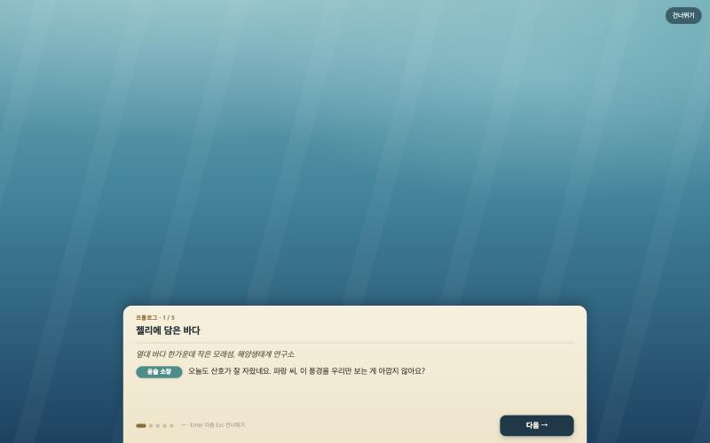
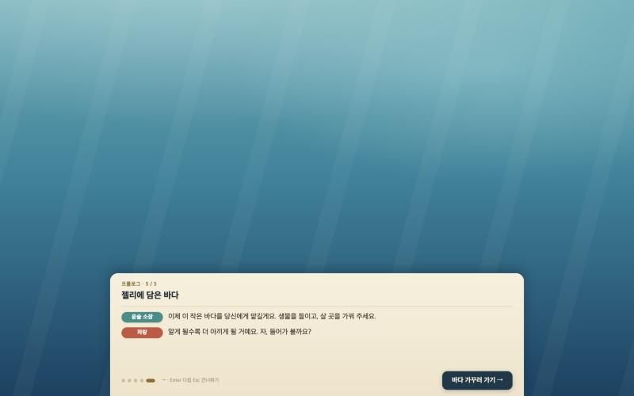
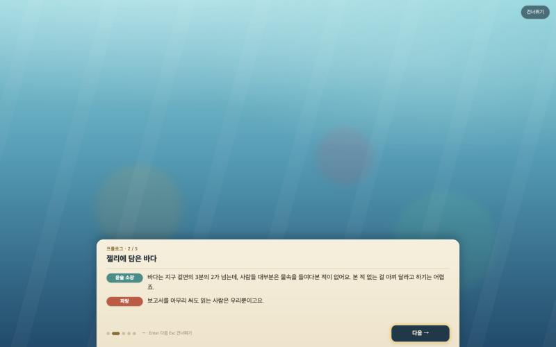
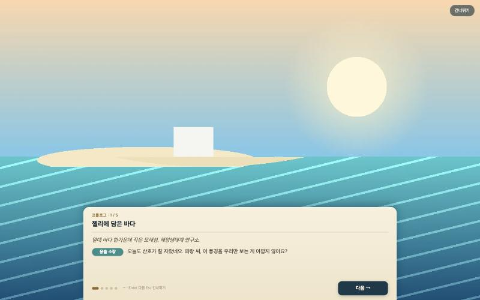
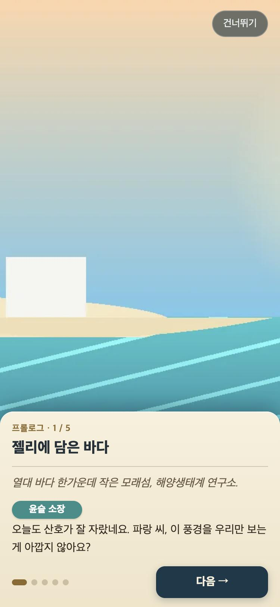

# 프롤로그 화면 보고서 (2026-11-12)

> **대니님 확인 필요**: 인물 이름(윤슬 소장, 파랑)·생김새·대사 5쪽은 PLAN.md 8.3절의 **가안**을 그대로 옮긴 거예요. 대니님이 아직 보지 않으셨어요. 바꾸실 때는 문장은 `ui/prologue-story.js`만, 생김새는 `docs/asset-manifest.yaml`의 프롬프트만 고치면 돼요(그림을 만들기 전에).

프롤로그를 게임과 떨어진 독립 모듈로 만들었어요. 게임 흐름(타이틀 → 처음 한 번 프롤로그 → 게임)에 끼우는 일은 P2 세션 몫이에요.

## 1. 약속 (P2가 쓰는 면)

```js
import { showPrologue } from './ui/prologue.js';
const r = await showPrologue({ root, onDone });   // r = { skipped: boolean }
```

| 항목 | 내용 |
|---|---|
| `root` | 화면을 붙일 요소. 없으면 `document.body`. 화면은 `position: fixed; inset: 0; z-index: 30`으로 뷰포트 전체를 덮어요(타이틀은 20) |
| `onDone({ skipped })` | 끝날 때 **한 번만** 불려요. [건너뛰기]·Esc는 `skipped: true`, 마지막 쪽 단추·마지막 쪽에서 →/Enter/Esc는 `skipped: false`(마지막 쪽 →/Enter/Esc는 코드로만 확인) |
| 반환값 | Promise. `onDone`과 같은 때, 같은 값으로 풀려요. 페이드아웃(0.45초) 뒤 화면을 DOM에서 지운 다음이에요 |
| 의존 | 외부 라이브러리 없음. 게임의 다른 모듈은 import하지 않아요. 같은 폴더의 `prologue-story.js`(데이터)와 `prologue.css`(스타일, `import.meta.url` 기준으로 `<link>`를 한 번만 붙임)만 써요 |
| 그림 경로 | `prologue-story.js`의 `art`는 게임 폴더 기준(`assets/story/institute.webp` 등, manifest 파일명 그대로). 모듈 위치 기준으로 풀어서, 어느 HTML에서 불러도 같은 파일을 찾아요 |
| 키 입력 | 열려 있는 동안 `window` 캡처 단계에서 →·Enter·Esc를 받아 `stopPropagation`해요. 게임의 키 조작으로 새지 않아요. 닫히면 리스너를 지워요 |
| 열리자마자 입력 | 열린 뒤 0.35초 동안의 클릭·키는 무시해요. 타이틀을 누른 손가락·Enter가 1쪽을 바로 넘기지 않게 하려는 거예요 |

P2가 끼울 때 참고할 점(추정, 아직 게임에 끼워 보지 않음):
- 실제 게임 장면을 흐리게 깔려면 3D 캔버스를 그대로 두고 그 위에 프롤로그를 띄우면 돼요. 그림이 없을 때의 바탕(`.owp-sea`)이 반투명 + `backdrop-filter: blur(10px)`라서 뒤 장면이 흐리게 비쳐요(데모 `?behind=1`로 확인함).
- 그림을 읽은 쪽은 불투명이라 뒤 장면이 보이지 않아요. 프롤로그 동안 렌더 루프를 멈출지는 P2가 정하면 돼요.
- "처음 한 번만" 판단(저장)과 "설정에서 다시 보기"는 이 모듈에 없어요. `skipped` 값과 상관없이 끝나면 "본 것"으로 저장하는 걸 권해요.

## 2. 화면 구성

| 요소 | 내용 |
|---|---|
| 그림 | 화면 가득(`object-fit: cover`, 위아래 40% 지점 기준). 쪽이 바뀌면 0.6초 페이드인, 16초 동안 1.04배→1배로 천천히 당겨지는 움직임 |
| 그림이 없을 때 | 바다색 세로 그라데이션(위 연한 청록 → 아래 짙은 바다) + 은은한 빛줄기, 반투명. 글은 그대로 보여요 |
| 종이 | 아래 가운데, 폭 `min(940px, 화면-32px)`, 높이 최소 `min(31vh, 300px)`. 그림 아래 30%를 덮는다는 화풍 기준(`docs/art-style.md`)에 맞췄어요. Sailing Master와 같은 크림색 종이 |
| 종이 안 | 위에서부터 `프롤로그 · n / 5` → 제목 "젤리에 담은 바다" → 대사 줄들 → 쪽 점 · 키 안내 · [다음 →] |
| 대사 줄 | 말하는 사람 이름표(윤슬 소장 청록 `#2f8f8a`, 파랑 산호 `#c9543e`. 흰 글씨가 읽히게 화풍 문서의 `#f0806a`보다 진하게) + 대사. 해설은 이름표 없이 기울인 갈색 글씨 |
| [건너뛰기] | 오른쪽 위 둥근 단추. 마지막 쪽에서는 숨겨요 |
| 마지막 쪽 단추 | "바다 가꾸러 가기 →" |
| 입력 | 클릭·터치: [다음], 또는 종이 밖 그림 영역 아무 곳이나. 종이 안 글자를 눌러서는 넘어가지 않아요. 키보드: → / Enter 다음, Esc 건너뛰기 |
| 좁은 화면(640px 이하) | 종이를 폭 가득, 이름표를 대사 위로 올림, 키 안내 숨김 |
| 움직임 줄이기 설정 | 빛줄기·그림 당김·대사 등장 애니메이션을 끔 |

파일

| 파일 | 하는 일 |
|---|---|
| `ui/prologue.js` | 화면 만들기·쪽 넘기기·그림 미리 읽기·입력 처리 |
| `ui/prologue-story.js` | 제목, 단추 문구, 인물 이름표, 5쪽의 그림 경로·대체 설명·대사 |
| `ui/prologue.css` | 스타일(클래스 접두사 `owp-`) |
| `prologue-demo.html` | 단독 확인 페이지. 끝나면 결과를 보여 주고 [프롤로그 다시 보기]. `?behind=1`이면 뒤에 색 덩어리를 깔아 반투명 바탕을 확인 |

## 3. 캡처 (노트북 가로 1440×900, 내장 브라우저)

그림이 없을 때(지금 기본 상태), 1쪽



그림이 없을 때, 마지막 5쪽(건너뛰기 숨김, "바다 가꾸러 가기 →")



뒤에 다른 장면이 있을 때(`?behind=1`), 2쪽. 노랑·분홍·초록 원이 흐리게 비쳐요



가짜 그림 1장을 `assets/story/institute.webp`(1600×900 WebP)에 임시로 넣었을 때, 1쪽. 가짜 그림은 커밋하지 않고 지웠어요



참고: 휴대폰 세로(375×812)에서 가짜 그림 1쪽



캡처할 때는 내장 브라우저 창이 숨어 있어 페이드 애니메이션이 중간에 멈춘 채로 찍혀서, 캡처 직전에만 페이지에 애니메이션 끄는 스타일을 넣었어요(코드에는 없음).

## 4. 확인함 / 추정

| 구분 | 내용 |
|---|---|
| 🟢 확인함 | 데모 페이지를 열면 1쪽이 대체 화면으로 떠요(그림 5장 모두 404 → `data-art="none"`) |
| 🟢 확인함 | 5쪽 넘기기: → 키(1→2), Enter(2→3, [다음]에 초점이 있어도 한 번만 넘어감), [다음] 클릭(3→4), 그림 영역 클릭(4→5) |
| 🟢 확인함 | 5쪽에서 단추 문구 "바다 가꾸러 가기 →", [건너뛰기] 숨김, 이름표 "윤슬 소장"·"파랑" |
| 🟢 확인함 | 마지막 단추 클릭 → 화면 제거, `{ skipped: false }` |
| 🟢 확인함 | 2쪽에서 Esc → 화면 제거, `{ skipped: true }`. [건너뛰기] 클릭 → `{ skipped: true }` |
| 🟢 확인함 | 열린 지 0.06초에 [다음] 클릭은 무시(1쪽 유지), 0.4초 뒤 클릭은 넘어감. 건너뛰기 두 번 + Esc를 겹쳐도 `onDone` 1번, 남은 화면 0개 |
| 🟢 확인함 | 다시 보기를 해도 스타일 `<link>`는 1개, 그림은 다시 요청하지 않음(모듈 안 캐시) |
| 🟢 확인함 | 가짜 그림이 있는 1쪽은 그림이 나오고(`naturalWidth 1600`), 그림이 없는 2쪽은 대체 화면으로 돌아감 |
| 🟢 확인함 | 휴대폰 세로 375px에서 가로 넘침 없음 |
| 🟡 확인함 | 콘솔에 JS 오류는 없어요. 다만 그림 5장이 아직 없어 `Failed to load resource: 404`가 장마다 1번씩 찍혀요. 네트워크 목록에서 404는 `assets/story/*.webp` 5개뿐인 것을 확인했어요. 그림이 들어오면 사라져요 |
| ⚪ 추정 | 터치: 클릭 이벤트로만 받아서 터치에서도 같게 동작할 거예요. 실제 터치 기기로는 해 보지 않았어요 |
| ⚪ 추정 | 실제 그림(인물이 나오는 1600×900)에서 얼굴이 종이에 가리지 않는지는 그림이 와야 알 수 있어요. 화풍 기준대로 아래 30%를 비워 그리면 맞을 거예요 |
| ⚪ 추정 | 게임(`index.html`)에 끼웠을 때의 동작은 확인하지 않았어요(P2 몫) |
